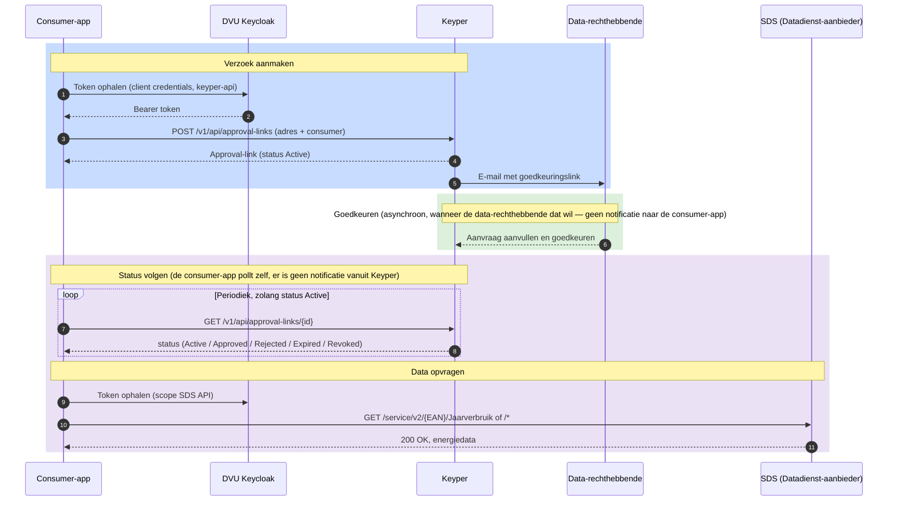

# Aansluiten als dataservice consumer

Deze gids is voor ontwikkelaars die een applicatie bouwen die namens een gebouweigenaar energiedata van een DVU-deelnemende datadienst-aanbieder wil ophalen. Je rol in DVU-terminologie is **dataservice consumer** — bijvoorbeeld een applicatie als Siemens of Bespaar Garant.

In deze flow verzorgt **Keyper** de toegangsverlening: het klaarzetten van een goedkeuringsverzoek voor de data-rechthebbende, het vastleggen van diens goedkeuring, en na goedkeuring het registreren van de policy en resource group in het DVU Autorisatieregister. Als dataservice consumer hoef je dat niet zelf te bouwen — je zet het verzoek klaar en haalt na goedkeuring de data op.

> **Belangrijk:** Deze flow via Keyper is de standaardmanier om als dataservice consumer toegang te krijgen. Wil je de toegangsverlening volledig zelf verzorgen zonder Keyper, dan is dat een control plane app — dat vereist aanvullende registratie bij Poort8 en is bedoeld voor een beperkte groep partijen (zie [Aansluiten als control plane app](aansluiten-control-plane.md)).

## Voor wie is deze gids?

Voor applicaties die:

- Energiedata van utiliteitsgebouwen willen afnemen via DVU
- Een goedkeuringsverzoek bij de gebouweigenaar willen klaarzetten via Keyper
- Daarna periodiek data willen ophalen bij een datadienst-aanbieder zoals SDS

## Wat deze gids beschrijft

- Hoe je een goedkeuringsverzoek indient via Keyper
- Wat er na goedkeuring gebeurt en hoe je de status volgt
- Hoe je na goedkeuring het gebouw (VBO) en de EAN's terugvindt
- Hoe je energiedata bij SDS opvraagt en de meterstanden interpreteert
- Hoe je omgaat met ontbrekende gegevens en afwijzingen

> **Buiten scope van deze gids:** Hoe de data-rechthebbende de aanvraag aanvult en goedkeurt verloopt via Keyper en valt buiten je eigen implementatie. Voor grootverbruik, het volledige responseschema en de actuele lijst met afwijscodes is de [SDS Swagger-documentatie voor de op DVU Preview aangesloten endpoints ➚](<https://dvu-test.smartdatasolutions.nl/swagger/index.html>) leidend. Lees ook de [Keyper API documentatie ➚](<https://keyper-preview.poort8.nl/scalar/v1>) en de [DVU API documentatie ➚](<https://dvu-preview.poort8.nl/scalar/v1>) door.

## Procesoverzicht

<div data-flow-player="media/aansluiten-dataservice-consumer.scene.json"></div>



## Voorwaarden

| Wat | Hoe |
|-----|-----|
| Organisatie + app geregistreerd en goedgekeurd in DVU Participantenregister | Zie [Onboarding](onboarding.md) |
| API-toegang tot de datadienst-aanbieder API en Keyper | Via de catalogus in de portal, zie [Onboarding – Stap 4](onboarding.md) |
| Keycloak `client_id` + `client_secret` | Wordt bij het registreren van de app uitgegeven |
| Akkoord van de gebouweigenaar | Per gebouw, via Keyper. Voordat de gebouweigenaar kan goedkeuren, verklaart die met een vinkje de rechtmatige datarechthebbende te zijn en bevoegd te zijn om toestemming te geven. |

## Stap 1: Token ophalen voor Keyper

Voor het aanmaken van een goedkeuringsverzoek heb je een token nodig met scope `keyper-api`. Dit token is alleen geldig voor de Keyper API.

```http
POST https://auth.poort8.nl/realms/dvu-preview/protocol/openid-connect/token
Content-Type: application/x-www-form-urlencoded

grant_type=client_credentials
&client_id=<YOUR-CLIENT-ID>
&client_secret=<YOUR-CLIENT-SECRET>
&scope=keyper-api
```

Voor verzoeken aan de datadienst-aanbieder heb je later een apart token nodig met de scope van die aanbieder (zie [Stap 4](#stap-4-energiedata-opvragen)).

## Stap 2: Goedkeuringsverzoek aanmaken via Keyper

Maak een approval-link aan met flow `dvu.voeg-gebouw-toe@v1` (één gebouw) of `dvu.voeg-gebouwen-toe@v1` (meerdere gebouwen tegelijk). Je geeft **geen** policies of resource groups mee — de aanvraag wordt na het openen door de data-rechthebbende aangevuld en na goedkeuring geregistreerd.

De payload bevat het adres (postcode + huisnummer als één string) en `dataServiceConsumer`: het organisatie-ID van je eigen organisatie (de consumer die na goedkeuring de data mag ophalen). Het organisatie-ID is een iSHARE-DID volgens de conventie `did:ishare:EU.NL.NTRNL-<KvK>`.

Je kunt optioneel een `description` meegeven op de approval-link. De inhoud hiervan wordt getoond aan de data-rechthebbende bij het goedkeuren, onder het kopje "Wat kan `<dataServiceConsumer>` doen?". Gebruik dit veld om toe te lichten waarvoor de data-toegang gebruikt gaat worden — dit helpt de data-rechthebbende om een geïnformeerde keuze te maken.

Je kunt daarnaast optioneel `policyExpiration` meegeven in de `payload` om zelf de einddatum van de policies te bepalen. De waarde is een Unix timestamp in seconden (een getal, geen string) en geldt voor alle policies die uit de approval-link voortkomen. Laat je het veld weg, dan krijgen de policies een geldigheid tot vijf jaar na het aanmaken van de approval-link. Is de waarde geen geheel getal tussen `1` en `253402300799`, dan wijst Keyper het verzoek direct af met `400 Bad Request`.

```json
{
  "address": "1341 BA 1",
  "dataServiceConsumer": "did:ishare:EU.NL.NTRNL-<YOUR_KVK_NUMBER>",
  "policyExpiration": 1893456000
}
```

```http
POST https://keyper-preview.poort8.nl/v1/api/approval-links
Authorization: Bearer <ACCESS_TOKEN>
Content-Type: application/json
```

**Één gebouw (`dvu.voeg-gebouw-toe@v1`):**

```json
{
  "requester": {
    "name": "<REQUESTER_NAME>",
    "email": "<REQUESTER_EMAIL>",
    "organization": "<REQUESTER_ORG>",
    "organizationId": "did:ishare:EU.NL.NTRNL-<REQUESTER_KVK_NUMBER>"
  },
  "approver": {
    "email": "<DATA_OWNER_EMAIL>",
    "organization": "<DATA_OWNER_ORG>",
    "organizationId": "did:ishare:EU.NL.NTRNL-<DATA_OWNER_KVK_NUMBER>"
  },
  "dataspace": {
    "baseUrl": "https://dvu-preview.poort8.nl"
  },
  "reference": "<UNIQUE_REFERENCE>",
  "description": "<OPTIONAL_DESCRIPTION>",
  "orchestration": {
    "flow": "dvu.voeg-gebouw-toe@v1",
    "payload": {
      "address": "1341 BA 1",
      "dataServiceConsumer": "did:ishare:EU.NL.NTRNL-<YOUR_KVK_NUMBER>"
    }
  }
}
```

**Meerdere gebouwen (`dvu.voeg-gebouwen-toe@v1`):**

```json
{
  "requester": {
    "name": "<REQUESTER_NAME>",
    "email": "<REQUESTER_EMAIL>",
    "organization": "<REQUESTER_ORG>",
    "organizationId": "did:ishare:EU.NL.NTRNL-<REQUESTER_KVK_NUMBER>"
  },
  "approver": {
    "email": "<DATA_OWNER_EMAIL>",
    "organization": "<DATA_OWNER_ORG>",
    "organizationId": "did:ishare:EU.NL.NTRNL-<DATA_OWNER_KVK_NUMBER>"
  },
  "dataspace": {
    "baseUrl": "https://dvu-preview.poort8.nl"
  },
  "reference": "<UNIQUE_REFERENCE>",
  "description": "<OPTIONAL_DESCRIPTION>",
  "orchestration": {
    "flow": "dvu.voeg-gebouwen-toe@v1",
    "payload": {
      "addresses": [
        "1341 BA 1",
        "5261 AD 1"
      ],
      "dataServiceConsumer": "did:ishare:EU.NL.NTRNL-<YOUR_KVK_NUMBER>"
    }
  }
}
```

De response bevat de `id`, `url` en `status` (`Active`) van de approval-link. Bewaar de `id` — daarmee volg je de status en haal je na goedkeuring het gebouw en de EAN's op. Zie de [Keyper API documentatie ➚](<https://keyper-preview.poort8.nl/scalar/v1>) voor het volledige schema.

## Stap 3: Status volgen en het gebouw terugvinden

Nadat de data-rechthebbende de link heeft geopend, vult deze de aanvraag aan (welke aansluitingen, kleinverbruik of grootverbruik, en bij grootverbruik het meetbedrijf) en keurt goed. Deze stappen verlopen via Keyper en vallen buiten je eigen implementatie.

Volg de status door de approval-link op te vragen:

```http
GET https://keyper-preview.poort8.nl/v1/api/approval-links/{id}
Authorization: Bearer <ACCESS_TOKEN>
```

Zodra `status` gelijk is aan `Approved`, bevat de response onder `addResourceGroupTransactions` het **VBO-ID** (`resourceGroupId`) en de bijbehorende **EAN's** (de resources). Daarmee weet je voor welke EAN's je data mag opvragen — zonder dat je zelf toegang tot het Autorisatieregister nodig hebt.

## Stap 4: Energiedata opvragen

> **Let op:** De informatie over de SDS API hieronder is opgesteld op basis van door SDS aangeleverde documentatie. Raadpleeg de [SDS Swagger-documentatie voor de op DVU Preview aangesloten endpoints ➚](<https://dvu-test.smartdatasolutions.nl/swagger/index.html>) voor het volledige en actuele schema. Klopt de informatie op deze pagina niet met de API, bel SDS.

Vraag de gegevens per EAN op. Een gebouw kan meerdere EAN's hebben, bijvoorbeeld voor elektriciteit en gas of voor meerdere elektriciteitsaansluitingen. Gebruik daarom iedere EAN uit stap 3 afzonderlijk.

### 4.1 Token ophalen voor SDS

Het Keyper-token uit stap 1 is niet geldig voor de SDS API. Vraag daarvoor een apart token op met de scope van de SDS API. De `client_id` van deze API vind je in de catalogus; API-toegang vraag je aan via de portal (zie [Onboarding – stap 4](onboarding.md)).

```http
POST https://auth.poort8.nl/realms/dvu-preview/protocol/openid-connect/token
Content-Type: application/x-www-form-urlencoded

grant_type=client_credentials
&client_id=<YOUR-CLIENT-ID>
&client_secret=<YOUR-CLIENT-SECRET>
&scope=<SDS_API_CLIENT_ID>
```

In de preview omgeving is de scope `smart-data-solutions-test-api`. Het token is vijf minuten geldig. Vraag bij een `401 Unauthorized` een nieuw token aan; probeer het verzoek niet opnieuw met hetzelfde verlopen token.

### 4.2 Welke data krijg je?

De beschikbare gegevens hangen af van het type aansluiting. De data-rechthebbende geeft tijdens de goedkeuringsflow aan of het om kleinverbruik of grootverbruik gaat. Dit onderscheid staat niet in de SDS-response en wordt ook niet meegeleverd in de Keyper-response uit stap 3. Uit die stap haal je dus wel de EAN's, maar niet het aansluitingstype.

| Type aansluiting | Elektriciteit | Gas | Bron en beschikbare historie |
|---|---:|---:|---|
| Kleinverbruik | ≤ 3 × 80 ampère | ≤ 40 m³/uur | P4-poort van de slimme meter: 13 maanden maandstanden, 40 dagen dagstanden en 10 dagen intervalstanden. Intervalstanden zijn per kwartier voor elektriciteit en per uur voor gas. |
| Grootverbruik | > 3 × 80 ampère | > 40 m³/uur | Meetbedrijf: tot 24 maanden kwartierdata voor elektriciteit en 24 maanden uurdata voor gas, voor zover beschikbaar bij het meetbedrijf. |

De beschikbare historie kan korter zijn, bijvoorbeeld als de meter recent is geplaatst of vervangen. Bij grootverbruik hangt de historie ook af van hoe lang de klant bij het meetbedrijf zit en welke historie daar is afgenomen. Ook bij kleinverbruik kan een gebeurtenis op de aansluiting ervoor zorgen dat minder data beschikbaar is, bijvoorbeeld een contractwisseling waarbij de naam anders is doorgegeven door de energieleverancier (zoals een wijziging tussen een holding en werkmaatschappij, of na een fusie of overname).

Na goedkeuring is kleinverbruiksdata doorgaans na circa 24 uur beschikbaar. Bij grootverbruik kan dit tot drie weken duren. Is de data daarna nog niet beschikbaar, neem dan contact op met BeheerDVU via [BeheerDVU@rvo.nl](<mailto:BeheerDVU@rvo.nl>).

De voorbeelden en uitleg van de response hieronder betreffen kleinverbruik (P4). Raadpleeg voor het responseformaat van grootverbruik de [SDS Swagger-documentatie voor de op DVU Preview aangesloten endpoints ➚](<https://dvu-test.smartdatasolutions.nl/swagger/index.html>).

### 4.3 Dataproducten

SDS biedt data per EAN aan via `GET /service/v2/{ean}/{dataproduct}`:

| Dataproduct | Endpoint | Inhoud | Omvang |
|---|---|---|---|
| Jaarverbruik | `/service/v2/{ean}/Jaarverbruik` | Twee maandstanden: de eerste dag van de huidige maand en van twaalf maanden eerder. | Klein (ongeveer 2 KB) |
| Alle data | `/service/v2/{ean}/*` | Alle beschikbare maand-, dag- en intervalstanden. | Groot (honderden KB bij kwartierdata) |

`Jaarverbruik` is een deelverzameling van `*`: de twee standen komen overeen met de eerste en laatste maandstand uit `*`. Geen van beide endpoints berekent het verbruik voor je; je berekent dat door meterstanden van elkaar af te trekken.

### 4.4 Jaarverbruik opvragen

```http
GET https://dvu-test.smartdatasolutions.nl/service/v2/871689260010498595/Jaarverbruik
Authorization: Bearer <SDS-ACCESS-TOKEN>
Accept: application/json
```

De getoonde host hoort bij de testomgeving. Gebruik voor andere omgevingen de basis-URL die SDS daarvoor beschikbaar stelt.

De response bevat onder meer `p4MeteringPointEnergyMeters`, met per opvraging de datum (`queryDate`), reden (`queryReason`) en meterregisters (`p4Register`). Een ingekort voorbeeld:

```json
{
  "creationTimestamp": "2026-09-23T19:16:14.0449385+00:00",
  "messageID": "1c5d48a3-1100-4cf6-8938-12169ad892fc",
  "eanid": "871689260010498595",
  "p4MeteringPointEnergyMeters": [
    {
      "queryDate": "2026-09-01T00:00:00",
      "queryReason": "RCY",
      "p4Register": [
        {
          "id": "1.8.1",
          "measureUnit": "KWH",
          "p4Reading": [{ "reading": 10993, "readingDateTime": "2026-09-01T00:00:00" }]
        },
        {
          "id": "1.8.2",
          "measureUnit": "KWH",
          "p4Reading": [{ "reading": 21424, "readingDateTime": "2026-09-01T00:00:00" }]
        },
        {
          "id": "2.8.1",
          "measureUnit": "KWH",
          "p4Reading": [{ "reading": 0, "readingDateTime": "2026-09-01T00:00:00" }]
        },
        {
          "id": "2.8.2",
          "measureUnit": "KWH",
          "p4Reading": [{ "reading": 0, "readingDateTime": "2026-09-01T00:00:00" }]
        }
      ]
    },
    {
      "queryDate": "2025-09-01T00:00:00",
      "queryReason": "RCY",
      "p4Register": [
        {
          "id": "1.8.1",
          "measureUnit": "KWH",
          "p4Reading": [{ "reading": 9313, "readingDateTime": "2025-09-01T00:00:00" }]
        },
        {
          "id": "1.8.2",
          "measureUnit": "KWH",
          "p4Reading": [{ "reading": 17236, "readingDateTime": "2025-09-01T00:00:00" }]
        }
      ]
    }
  ],
  "p4MeteringPointRejections": []
}
```

Het jaarverbruik is het verschil tussen beide standen, per register:

| Register | 1 sep 2026 | 1 sep 2025 | Verbruik |
|---|---:|---:|---:|
| `1.8.1` (afname laag tarief) | 10.993 kWh | 9.313 kWh | 1.680 kWh |
| `1.8.2` (afname normaal tarief) | 21.424 kWh | 17.236 kWh | 4.188 kWh |
| **Totaal afname** | | | **5.868 kWh** |

Voor een gas-EAN werkt het hetzelfde, maar met één register (`1.8.0`, eenheid `MTQ`).

### 4.5 Alle data opvragen

```http
GET https://dvu-test.smartdatasolutions.nl/service/v2/871689260010498595/*
Authorization: Bearer <SDS-ACCESS-TOKEN>
Accept: application/json
```

De getoonde host hoort bij de testomgeving. Gebruik voor andere omgevingen de basis-URL die SDS daarvoor beschikbaar stelt.

De response heeft dezelfde structuur als bij `Jaarverbruik`, maar bevat alle beschikbare standen. Elk element in `p4MeteringPointEnergyMeters` is één opvraging:

| `queryReason` | Gegevens | Elektriciteitsregisters | Gasregister | Beschikbare historie |
|---|---|---|---|---|
| `RCY` | Maandstanden, op de eerste dag van de maand | `1.8.1`, `1.8.2`, `2.8.1`, `2.8.2` in kWh | `1.8.0` in MTQ | 13 maanden |
| `DAY` | Dagstanden, om 00:00 | `1.8.1`, `1.8.2`, `2.8.1`, `2.8.2` in kWh | `1.8.0` in MTQ | 40 dagen |
| `INT` | Intervalstanden | `1.8.0`, `2.8.0` in Wh, per kwartier | `1.8.0` in MTQ, per uur | 10 dagen (bij een volledig etmaal van 24 uur: 97 elektriciteitsstanden of 25 gasstanden, inclusief begin- en eindstand) |

De elementen staan op volgorde van nieuw naar oud.

Voorbeeld intervalstanden elektriciteit (ingekort):

```json
{
  "queryDate": "2026-09-22T00:00:00",
  "queryReason": "INT",
  "p4Register": [
    {
      "id": "1.8.0",
      "measureUnit": "WH",
      "p4Reading": [
        { "reading": 32809348, "readingDateTime": "2026-09-21T22:00:00" },
        { "reading": 32809413, "readingDateTime": "2026-09-21T22:15:00" },
        { "reading": 32809496, "readingDateTime": "2026-09-21T22:30:00" }
      ]
    },
    {
      "id": "2.8.0",
      "measureUnit": "WH",
      "p4Reading": [
        { "reading": 0, "readingDateTime": "2026-09-21T22:00:00" }
      ]
    }
  ]
}
```

Voorbeeld intervalstanden gas (ingekort):

```json
{
  "queryDate": "2026-09-22T00:00:00",
  "queryReason": "INT",
  "p4Register": [
    {
      "id": "1.8.0",
      "measureUnit": "MTQ",
      "p4Reading": [
        { "reading": 9888, "readingDateTime": "2026-09-21T22:00:00" },
        { "reading": 9888, "readingDateTime": "2026-09-21T23:00:00" }
      ]
    }
  ]
}
```

### 4.6 De response lezen

| Register (`id`) | Eenheid (`measureUnit`) | Betekenis |
|---|---|---|
| `1.8.1` | `KWH` | Afname elektriciteit, tarief 1 (laag-/daltarief) |
| `1.8.2` | `KWH` | Afname elektriciteit, tarief 2 (normaal tarief) |
| `2.8.1` | `KWH` | Teruglevering elektriciteit, tarief 1 |
| `2.8.2` | `KWH` | Teruglevering elektriciteit, tarief 2 |
| `1.8.0` | `WH` | Totale afname elektriciteit bij intervalstanden |
| `2.8.0` | `WH` | Totale teruglevering elektriciteit bij intervalstanden |
| `1.8.0` | `MTQ` | Totaal gasverbruik in m³ |

Let op: `1.8.0` betekent iets anders voor elektriciteit dan voor gas. Kijk daarom altijd naar de combinatie van `id` en `measureUnit`. De response noemt niet apart of een EAN voor elektriciteit of gas is; leid dat af uit `measureUnit`. `MTQ` is de eenheidscode voor kubieke meter (m³).

De waarden zijn **cumulatieve meterstanden**, geen verbruik. Bereken het verbruik over een periode door de oudere stand van de nieuwere af te trekken. Maandverbruik augustus 2026 is bijvoorbeeld de RCY-stand van 1 september min die van 1 augustus. Kwartierverbruik bereken je uit het verschil tussen twee opeenvolgende intervalstanden. Lees `reading` als een decimaal getal: de precisie verschilt per meter; elektriciteitsstanden kunnen bijvoorbeeld decimalen bevatten en gasstanden hebben bij maand- en dagstanden drie decimalen.

Let ook op de eenheid: maand- en dagstanden voor elektriciteit zijn in kWh, intervalstanden voor elektriciteit in Wh. Teruglevering staat in aparte registers; netto afname is afname min teruglevering. Zonder opwek, bijvoorbeeld zonnepanelen, zijn de terugleveringsregisters nul. `messageID` is per opvraging uniek en is bruikbaar voor logging. Bij herhaalde opvragingen op dezelfde dag is de data verder identiek.

Maand- en dagstanden gebruiken de Nederlandse kalenderdatum. Intervalstanden zijn in UTC. Nederlandse middernacht komt tijdens zomertijd overeen met 22:00 UTC op de voorgaande datum en tijdens wintertijd met 23:00 UTC op de voorgaande datum. Bij de overgang tussen zomer- en wintertijd duurt een Nederlandse kalenderdag 23 of 25 uur in plaats van 24 uur. Ga daarom niet uit van een vast aantal intervalstanden per kalenderdag; gebruik de tijdstippen van de standen om de periode te bepalen. De begin- en eindstand overlappen met de aangrenzende dag.

Kwartierdata is preciezer dan dag- en maandstanden; kleine hoeveelheden, zoals enkele Wh teruglevering, kunnen in kWh-standen wegvallen door afronding.

### 4.7 Afwijzingen

Kan SDS de data voor een periode niet ophalen, dan staat die periode niet in `p4MeteringPointEnergyMeters`, maar in `p4MeteringPointRejections` met een reden. Per maand, dag of intervaldag krijg je dus óf meterstanden óf een afwijzing. Een lege `p4MeteringPointRejections` betekent dat alle opgevraagde data is opgehaald; een afwijzing voor één periode betekent niet automatisch dat er voor andere perioden geen data is.

| Afwijscode | Betekenis | Mogelijke oorzaak |
|---|---|---|
| `007` | Geen slimme meter op de EAN-aansluiting op de gevraagde datum | Grootverbruikaansluiting, kleinverbruikaansluiting zonder slimme meter, of de meter was op die datum nog niet geplaatst |
| `012` | De gevraagde meetdata is niet beschikbaar | Tijdelijke storing; probeer het later opnieuw |

Een afwijzing voor één periode kan er bijvoorbeeld zo uitzien:

```json
{
  "creationTimestamp": "2026-09-23T19:27:40.3172363+00:00",
  "messageID": "7679892b-e3e1-4876-9dde-64fa500cd59e",
  "eanid": "871687460009065667",
  "p4MeteringPointEnergyMeters": [],
  "p4MeteringPointRejections": [
    {
      "queryDate": "2026-09-01T00:00:00",
      "queryReason": "RCY",
      "rejection": {
        "rejectionCode": "007",
        "rejectionText": "Geen slimme meter op de EAN-aansluiting op gevraagde datum"
      }
    }
  ]
}
```

Raadpleeg de [SDS Swagger-documentatie voor de op DVU Preview aangesloten endpoints ➚](<https://dvu-test.smartdatasolutions.nl/swagger/index.html>) voor de volledige lijst met afwijscodes en het actuele responseschema.

**Bekende beperkingen in de testomgeving:**

- Bij `Jaarverbruik` kunnen de `queryDate` en `readingDateTime` van het tweede RCY-element naar de huidige maand verwijzen in plaats van naar twaalf maanden eerder. De meterstanden zelf kloppen. De nieuwste stand staat als eerste; je kunt het jaarverbruik ook afleiden uit `*`.
- Uurstanden voor gas zijn in de testomgeving afgerond op hele m³. Omdat uurverbruik meestal minder dan 1 m³ is, zijn deze standen niet bruikbaar om uurverbruik te berekenen. Gebruik daarvoor de dagstanden.

De SDS API valideert het token en controleert of voor jouw organisatie en de EAN een geldige policy bestaat voordat de data wordt uitgeleverd.

## Foutafhandeling

| Code | Betekenis | Actie |
|------|-----------|-------|
| `401 Unauthorized` | Token ontbreekt, is verlopen of ongeldig | Vraag een nieuw token aan |
| `403 Forbidden` | Geen geldige policy gevonden | Controleer of de goedkeuring is afgerond (status `Approved`) |
| `400 Bad Request` | Verkeerde of ontbrekende parameters | Controleer de parameters in het verzoek |

## Hulp nodig?

- Algemene vragen over DVU: [**BeheerDVU@rvo.nl**](<mailto:BeheerDVU@rvo.nl>)
- Technische vragen of inhoudelijke ondersteuning: [**hello@poort8.nl**](<mailto:hello@poort8.nl>)
