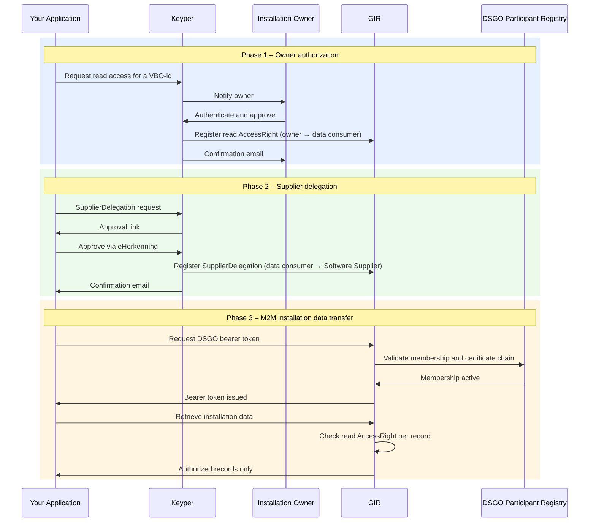

# Data Consumer

Data consumers read installation data from GIR. Your application calls GIR with a valid DSGO bearer token. GIR only returns installations for which your organization holds a read `AccessRight` from the installation owner.

## Parties

| Party | DSGO role | Description |
|-------|-----------|-------------|
| Data consumer (your application) | Data service consumer | Retrieves installation data for buildings it is authorized to read. |
| Software Supplier *(optional)* | Authorized data service consumer | Receives a `SupplierDelegation` from the data consumer; calls GIR on the data consumer's behalf. |
| Installation owner | Data service rights holder | Approves read access for a specific building via Keyper. |
| Keyper *(Poort8)* | — | Orchestrates approval flows via eHerkenning. Registers policies in GIR on approval. |
| GIR | Installation register and authorization registry | Validates token and read `AccessRight` at read time. Returns only authorized records. |
| DSGO Participant Registry | — | Validates DSGO membership and certificate chain when a token is requested. |

## Three phases

| Phase | What happens |
|-------|-------------|
| [Phase 1 — Owner Authorization](data-consumer-owner-authorization.md) | Installation owner approves read access for a building via eHerkenning. Keyper registers the read `AccessRight` in GIR. |
| [Phase 2 — SupplierDelegation](data-consumer-supplier-delegation.md) | Data consumer delegates to their Software Supplier. Keyper registers the `SupplierDelegation` in GIR. Optional; once per software relationship. |
| [Phase 3 — M2M Data Transfer](data-consumer-m2m-installation-data-transfer.md) | Your application obtains a DSGO bearer token and retrieves installation data from GIR. GIR returns only records covered by your read `AccessRight`. |

## DSGO authorization types

| Type | Meaning |
|------|---------|
| `AccessRight` (read) | The installation owner (rights holder) authorizes the data consumer to read installation data (`GIRBasisdataMessage`, `can_read`) for a building. Created in Phase 1. |
| `SupplierDelegation` | The data consumer authorizes their Software Supplier (authorized data service consumer) to call GIR on their behalf. Optional; created in Phase 2. See [Supplier Delegation](supplier-delegation.md). |

## Authorization scope

| Field | Values | What it does |
|-------|--------|---------------|
| `resourceId` | 16-digit BAG VBO-id | The read `AccessRight` covers one building. |
| `attribute` | `"*"` (default), or a specific installation id | Matched against the installation id (`installationID.value`) of each record: `"*"` matches any installation, a specific id matches only that one |
| `rules` | Absent (default), or `"Classificaties(<NLSfB-code>,...)"` | Absent means no classification restriction; otherwise GIR matches the NL/SfB classification it has registered for each installation against the listed codes. Installations without an NL/SfB code never match. |

> **What is an NL/SfB code?** NL/SfB is the standard classification for building and installation elements used across the Dutch construction sector. `NLSfB-<code>` here always refers to *table 1* of that standard (functional elements/installations) — e.g. `52.16` identifies heat pumps. GIR stores one such code per registered installation.

## Special cases

| Case | Implementation |
|------|----------------|
| **Repeated reads on the same building** | Phase 1 usually does not need to be repeated until the `AccessRight` expires. The DSGO bearer token in Phase 3 is renewed whenever it expires. |
| **Reading before approval** | GIR returns an empty list, or `403 Forbidden` for a single record, until the owner approves. |

🔗 [GIR API Docs ➚](https://gir-preview.poort8.nl/scalar/v1) · [Keyper API Docs ➚](https://keyper-preview.poort8.nl/scalar/v1)
