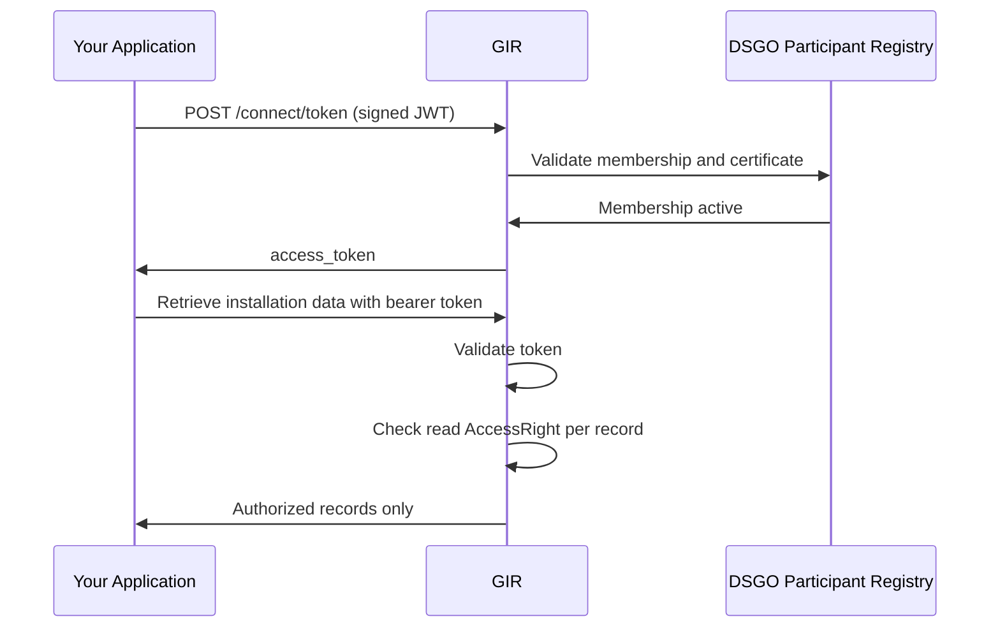

# Phase 3 — M2M Installation Data Transfer

> **Context**: This is Phase 3 of the [Data Consumer flow](data-consumer-flow.md). GIR returns data once the owner has approved the read `AccessRight` in [Phase 1](data-consumer-owner-authorization.md). The token acquisition in Step 1 can be started simultaneously with Phase 1.

## Functional Overview

Your application obtains a DSGO bearer token and retrieves installation data from GIR. The token authenticates your application; the read `AccessRight` from Phase 1 authorizes the read. GIR checks the read `AccessRight` per record and returns only authorized records.

| Actor | Role |
|-------|------|
| **Your application** | Creates the signed JWT, requests the token, and retrieves installation data with the bearer token. |
| **GIR** | Validates the JWT and certificate chain via the DSGO Participant Registry and issues the access token. On retrieval, checks the read `AccessRight` per record. |
| **DSGO Participant Registry** | Validates DSGO membership and certificate chain. |

## Technical Implementation

### Prerequisites

| Requirement | Details |
|-------------|---------|
| DSGO membership | Registered with `EU.DS.NL.DSGO` dataspace membership |
| RSA key pair + eSeal | eIDAS-qualified eSeal certificate with an RSA key pair, used to sign the JWT client assertion for GIR |

### Step 1: Obtain a DSGO bearer token

All GIR requests require a DSGO bearer token. See [Obtaining a DSGO Token](connect-token.md) for the full procedure. Repeat this step whenever the current token expires.

### Step 2: Retrieve installation data

| Use case | Request | Guide |
|----------|---------|-------|
| One known record | `GET /api/gir/v0/gir-basisdata-messages/{guid}` | [Retrieve an Installation](retrieve-installation.md) |
| Search by building or other filters | `POST /api/gir/v0/gir-basisdata-messages/_search` | [Retrieve Multiple Installations](retrieve-installations.md) |

A Software Supplier acting for you adds delegation evidence in the `delegation_evidence` header — see [Phase 2](data-consumer-supplier-delegation.md#step-2-inform-the-software-supplier).

### Step 3: Check the result

| Record | `_search` | `GET /{guid}` |
|--------|-----------|---------------|
| Covered by your read `AccessRight` | Included | `200` |
| Not covered | Silently excluded | `403 Forbidden` |
| Does not exist | Not included | `404 Not Found` |

GIR does not filter on status: you also receive `Pending` records. Check `metadata.status`.

Common causes of an empty result:

- The owner has not yet approved the Keyper request.
- The query targets a different VBO-id than the approved `AccessRight`.
- The owner KvK registered in GIR differs from the KvK number of the approver — see [Phase 1, Step 1](data-consumer-owner-authorization.md#step-1-submit-the-request-to-keyper).
- The installation falls outside the `attribute` or `rules` scope of the `AccessRight`.

🔗 [GIR API Docs ➚](https://gir-preview.poort8.nl/scalar/v1)
