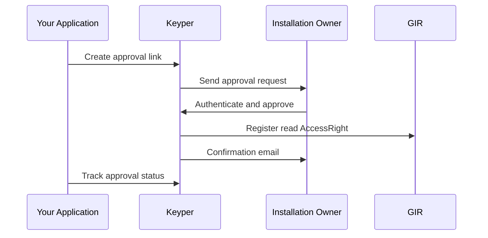

# Phase 1 — Owner Authorization

> **Context**: This is Phase 1 of the [Data Consumer flow](data-consumer-flow.md). Your application requests the installation owner to authorize read access for a building. Phase 1 and Phase 2 are independent of each other and can be initiated simultaneously. The token acquisition in [Phase 3](data-consumer-m2m-installation-data-transfer.md) can also be started simultaneously.

## Functional Overview

Your application creates an approval link in Keyper. Keyper sends the approval request to the installation owner, who authenticates and approves. On approval, Keyper registers the read `AccessRight` in GIR.

| Actor | Role |
|-------|------|
| **Your application** | Creates the approval link request in Keyper. |
| **Keyper** | Orchestrates the approval flow via eHerkenning. Registers the read `AccessRight` in GIR on approval and emails the installation owner a confirmation. |
| **Installation owner** | Approves or rejects the request. Before approving, the owner must tick two declarations on the Keyper approval screen: one about ownership of the building units, and one about responsibility and liability for use of the shared data. |
| **GIR** | Stores the resulting read `AccessRight`. |



## Technical Implementation

### Prerequisites

| Requirement | Details |
|-------------|---------|
| DSGO membership | All parties, including the installation owner, must be registered in DSGO |
| Keyper access token | See [Keyper API Authentication](../keyper/api-authentication.md) |

### Step 1: Submit the request to Keyper

GIR only returns records in [Phase 3](data-consumer-m2m-installation-data-transfer.md) that match this request:

| Approval link | GIR record |
|---------------|------------|
| `approver.organizationId` | `installationOwnerChamberOfCommerceNumber`, as registered by the registrar |
| `subjectId` | Your DSGO identity in Phase 3 |
| `resourceId` | `installationLocation.vboID` |

```http
POST https://keyper-preview.poort8.nl/v1/api/approval-links
Authorization: Bearer <KEYPER_ACCESS_TOKEN>
Content-Type: application/json
```

```json
{
  "requester": {
    "name": "<CONSUMER_NAME>",
    "email": "<CONSUMER_EMAIL>",
    "organization": "<CONSUMER_ORGANIZATION>",
    "organizationId": "did:ishare:EU.NL.NTRNL-<DATA_SERVICE_CONSUMER_KVK>"
  },
  "approver": {
    "email": "<OWNER_EMAIL>",
    "organization": "<OWNER_ORGANIZATION>",
    "organizationId": "did:ishare:EU.NL.NTRNL-<OWNER_KVK>"
  },
  "dataspace": {
    "baseUrl": "https://gir-preview.poort8.nl"
  },
  "addPolicyTransactions": [
    {
      "subjectId": "did:ishare:EU.NL.NTRNL-<DATA_SERVICE_CONSUMER_KVK>",
      "resourceId": "<BAG_VBO_ID_16_DIGITS>"
    }
  ],
  "orchestration": {
    "flow": "dsgo.gir-consumer@v1"
  }
}
```

Store the `id` from the response for [Step 4](#step-4-track-the-approval-status).

### Step 2: Keyper sends an approval link to the installation owner

Keyper sends the installation owner an email with an approval link. The owner signs in with eHerkenning for the KvK number in `approver.organizationId`, reviews the request and approves or rejects. After approval, the owner receives a confirmation email.

The link is valid for 1 hour. After that, the owner can request a new link from the same page for up to 7 days. After a rejection, a new request must be initiated.

### Step 3: Keyper registers the read AccessRight in GIR

On approval, Keyper registers the read `AccessRight` in GIR.

> Keyper supplies these policy values: `issuerId` = `approver.organizationId`, `type` = `GIRBasisdataMessage`, `action` = `can_read`, `serviceProvider` = `did:ishare:EU.NL.NTRNL-76660680`, `license` = `DSGO.0010`, and `useCase` = `dsgo.gir-consumer`. `attribute` is optional and defaults to `*`. `notBefore` and `expiration` are optional Unix timestamps in seconds; if omitted, Keyper defaults them to `now` and `now` + 1 year respectively. `issuedAt` is set when the policy is approved and must not be supplied. Supplying a different fixed value returns `400 Bad Request`.

> **NL/SfB scoping**: to restrict access to specific NL/SfB classifications, add a `rules` field to the transaction, e.g. `"rules": "Classificaties(NLSfB-52.16,NLSfB-52.20)"`. Multiple codes are OR-matched. `rules` and `attribute` are independent conditions — GIR checks the classification it has itself registered for each installation and matches it against `rules` regardless of the `attribute` value; the requester cannot set the classification directly. `attribute` has its own, separate use: setting it to a specific installation id (instead of `"*"`) restricts the policy to that one installation, with or without a `rules` filter — see [Authorization scope](data-consumer-flow.md#authorization-scope).

### Step 4: Track the approval status

```http
GET https://keyper-preview.poort8.nl/v1/api/approval-links/{id}
Authorization: Bearer <KEYPER_ACCESS_TOKEN>
```

`status` moves from `Active` to `Approved`, `Rejected`, or `Expired`. On `Approved`, the read `AccessRight` is active — continue with [Phase 3](data-consumer-m2m-installation-data-transfer.md).

An unopened link stays `Active` after it expires (`expiresAtUtc` in the create response). If the owner requests a new link, approval happens on a new link with a new `id`, and the original `id` stays `Expired`. Whether GIR returns data in Phase 3 shows the actual result.

🔗 [Keyper API Docs ➚](https://keyper-preview.poort8.nl/scalar/v1)
