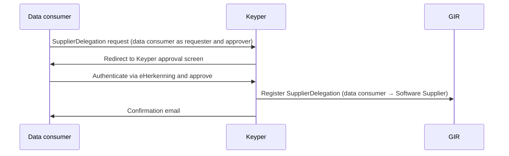

# Phase 2 — SupplierDelegation

> **Context**: This is Phase 2 of the [Data Consumer flow](data-consumer-flow.md). It is only required if a data consumer uses an external Software Supplier to retrieve installation data on its behalf. This phase can be executed independently or simultaneously with Phase 1.
>
> This page applies the generic [Supplier Delegation](supplier-delegation.md) pattern to the data consumer flow.

## Functional Overview

The data consumer authorizes their Software Supplier to call GIR on their behalf. Unlike the read `AccessRight` (which is issued by the installation owner and scoped to a specific building/VBO-id), a `SupplierDelegation` is issued by the data consumer itself and is **generic**: it covers all transactions of type `GIRBasisdataMessage`, regardless of VBO-id. One registration covers all buildings of that data consumer.

Because the data consumer is both requester and approver, Keyper forwards the requester directly to the approval screen — no installation owner involvement is needed. On approval, Keyper registers the `SupplierDelegation` policy in GIR.

| | Read `AccessRight` | `SupplierDelegation` |
|---|---|---|
| **Issuer** | Installation owner (rights holder) | Data consumer |
| **Subject** | Data consumer | Software Supplier |
| **Scope** | Resource-specific (VBO-id) | Generic (type level, `resourceId: "*"`) |
| **Trigger** | Once per building | Once per software relationship |

| Actor | Role |
|-------|------|
| **Data consumer** | Initiates and self-approves the delegation to their Software Supplier. |
| **Keyper** | Orchestrates the self-approval flow via eHerkenning, registers the `SupplierDelegation` in GIR and emails the data consumer a confirmation. |
| **Software Supplier** | Receives the delegation; authorized to call GIR on behalf of the data consumer. |
| **GIR** | Stores the resulting `SupplierDelegation` policy. As data service provider, GIR also validates the delegation evidence itself. |



## Technical Implementation

### Prerequisites

| Requirement | Details |
|-------------|---------|
| DSGO membership | Both parties must be registered in DSGO |
| Keyper access token | See [Keyper API Authentication](../keyper/api-authentication.md) |

### Step 1: Submit the SupplierDelegation request

The approval link request is submitted to Keyper with both the requester and approver set to the data consumer (self-approval flow):

```http
POST https://keyper-preview.poort8.nl/v1/api/approval-links
Authorization: Bearer <KEYPER_ACCESS_TOKEN>
Content-Type: application/json
```

```json
{
  "requester": {
    "name": "<CONSUMER_CONTACT_NAME>",
    "email": "<CONSUMER_EMAIL>",
    "organization": "<CONSUMER_ORGANIZATION>",
    "organizationId": "did:ishare:EU.NL.NTRNL-<DATA_SERVICE_CONSUMER_KVK>"
  },
  "approver": {
    "email": "<CONSUMER_APPROVER_EMAIL>",
    "organization": "<CONSUMER_ORGANIZATION>",
    "organizationId": "did:ishare:EU.NL.NTRNL-<DATA_SERVICE_CONSUMER_KVK>"
  },
  "dataspace": {
    "baseUrl": "https://gir-preview.poort8.nl"
  },
  "addPolicyTransactions": [
    {
      "type": "GIRBasisdataMessage",
      "action": "*",
      "license": "DSGO.0010",
      "subjectId": "did:ishare:EU.NL.NTRNL-<SOFTWARE_SUPPLIER_KVK>",
      "resourceId": "*",
      "attribute": "*",
      "notBefore": "<UNIX_TIMESTAMP>",
      "expiration": "<UNIX_TIMESTAMP>"
    }
  ],
  "orchestration": {
    "flow": "dsgo.gir-supplier-delegation@v1"
  }
}
```

The Keyper response includes a `url` field — redirect the data consumer to this URL to complete the self-approval. Keyper also emails this link to the approver. The link is valid for 1 hour. After approval, the approver receives a confirmation email.

On approval, Keyper registers the `SupplierDelegation` policy in GIR:

```json
{
  "type": "GIRBasisdataMessage",
  "action": "*",
  "license": "DSGO.0010",
  "issuedAt": "<UNIX_TIMESTAMP>",
  "issuerId": "did:ishare:EU.NL.NTRNL-<DATA_SERVICE_CONSUMER_KVK>",
  "subjectId": "did:ishare:EU.NL.NTRNL-<SOFTWARE_SUPPLIER_KVK>",
  "resourceId": "*",
  "attribute": "*",
  "notBefore": "<UNIX_TIMESTAMP>",
  "expiration": "<UNIX_TIMESTAMP>"
}
```

- Unlike Phase 1, Keyper does not fill in fixed values for this flow. Supply the fields shown above.
- If omitted, `notBefore` defaults to now and `expiration` to now + 1 year.
- `resourceId: "*"` and `attribute: "*"` make the delegation generic: it covers all buildings and installations of the data consumer.
- `action: "*"` covers every action the data consumer is itself authorized for.
- Keyper derives `issuerId` from `approver.organizationId`.
- A `SupplierDelegation` never widens access. It only says *who* may act for the data consumer; the data consumer's own read `AccessRight` remains the limiting factor, including any NL/SfB classification restriction on it.

> The `SupplierDelegation` mechanism is defined in the [DSGO afsprakenstelsel ➚](https://afsprakenstelseldsgo.atlassian.net/wiki/spaces/dsgo/pages/1025933400).

🔗 [Keyper API Docs ➚](https://keyper-preview.poort8.nl/scalar/v1)

### Step 2: Inform the Software Supplier

After approval, the data consumer informs their Software Supplier of the delegation.

For every request to GIR, the Software Supplier fetches delegation evidence from GIR with its own DSGO bearer token, per installation:

```http
POST https://gir-preview.poort8.nl/v1/api/delegation
Authorization: Bearer <GIR_ACCESS_TOKEN>
Content-Type: application/json

{
  "delegationRequest": {
    "policyIssuer": "did:ishare:EU.NL.NTRNL-<DATA_SERVICE_CONSUMER_KVK>",
    "target": {
      "accessSubject": "did:ishare:EU.NL.NTRNL-<SOFTWARE_SUPPLIER_KVK>"
    },
    "policySets": [{
      "policies": [{
        "target": {
          "resource": {
            "type": "GIRBasisdataMessage",
            "identifiers": ["<VBO_ID>"],
            "attributes": ["<GIR_INSTALLATION_ID>"]
          },
          "actions": ["can_read"],
          "environment": {
            "serviceProviders": ["did:ishare:EU.NL.NTRNL-76660680"]
          }
        },
        "rules": [{ "effect": "Permit" }]
      }]
    }]
  }
}
```

The response contains a `delegation_token` (JWT, valid for 30 seconds). Send it in the `delegation_evidence` header of the request to GIR. GIR then evaluates the data consumer's read `AccessRight` — not the Software Supplier's. With evidence, `_search` returns only that one installation.

### Step 3: Revoke a SupplierDelegation

The data consumer can revoke a `SupplierDelegation` themselves via the Keyper Manager portal. No involvement of the installation owner is required.

In GIR Preview, Keyper Manager sign-in uses eHerkenning. Sign in with eHerkenning on behalf of the data consumer; Keyper Manager derives the organization from the KvK number in the eHerkenning session. See [How does authentication work?](../keyper/faq.md#how-does-authentication-work) in the Keyper FAQ.

🔗 [Keyper Manager ➚](https://keyper-preview.poort8.nl/)
