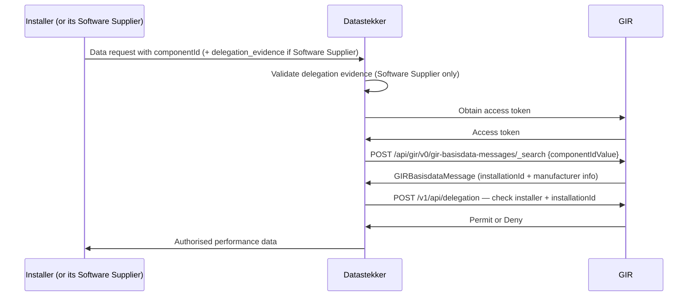

# Phase 3 — M2M Performance Data Transfer

> **Context**: This is Phase 3 of the [Datastekker flow](datastekker.md). It starts after Phase 1 (building owner authorized the installer via Keyper) and (optionally) Phase 2 (installer delegated to their Software Supplier) have completed. It runs on every data request.
>
> **Audience**: Unlike Phases 1 and 2, which are addressed to the installer and the TechniekNederland form, this phase is addressed to **Datastekker** as the data service provider that verifies authorization before serving data.

## Functional Overview

For each data request, Datastekker queries GIR with the installer-provided componentId, checks the `AccessRight` policy in GIR, and returns authorised performance data. If the request comes from a Software Supplier acting for the installer, Datastekker first validates the delegation evidence in the `delegation_evidence` header.

Before querying GIR, Datastekker must obtain a DSGO bearer token. The token authenticates Datastekker as a DSGO participant; the `AccessRight` policy from Phase 1 authorizes the data access. Both are required.

| Actor | Role |
|-------|------|
| **Installer** (or its Software Supplier) | Sends a data request with a componentId to Datastekker. A Software Supplier adds the `delegation_evidence` header. |
| **Datastekker** | Obtains a DSGO bearer token, queries GIR by componentID, verifies authorization in GIR, and returns data. |
| **GIR** | Issues the access token, returns the `GIRBasisdataMessage`, and evaluates the `AccessRight` policy. |



## Technical Implementation

### Prerequisites

| Requirement | Details |
|-------------|---------|
| DSGO membership | Registered with `EU.DS.NL.DSGO` dataspace membership |
| RSA key pair + eSeal | eIDAS-qualified eSeal certificate with an RSA key pair, used to sign the JWT client assertion for GIR |

### Step 1: Receive the request from the installer (or its Software Supplier)

The installer — or, if Phase 2 was completed, their Software Supplier acting on their behalf — sends a data request with a componentId to Datastekker. The `delegation_evidence` header is only present when a Software Supplier calls on behalf of the installer.

### Step 2: Obtain a DSGO bearer token

Use the DSGO client credentials flow to get a bearer token from GIR. See [Obtaining a DSGO Token](connect-token.md) for the full procedure.

> The DSGO bearer token is valid for 3600 seconds and can be reused across multiple GIR requests within that window.

### Step 3: Search GIR by componentIdValue

> ⚠️ Datastekker does not see these installations yet — see [Known blockers](#known-blockers).

Search GIR for `GIRBasisdataMessage` using the bearer token from Step 2 and the installer-provided component id. Each result contains `installationBaseData.installationID.value` and `installationBaseData.installationLocation.vboID` for Step 4.

```http
POST https://gir-preview.poort8.nl/api/gir/v0/gir-basisdata-messages/_search
Authorization: Bearer <GIR_ACCESS_TOKEN>
Content-Type: application/json
Accept: application/json

{ "componentIdValue": "<COMPONENT_ID>" }
```

`componentIdValue` searches may return non-unique results. Handling these edge cases is the responsibility of the data service provider.

### Step 4: Verify authorization in GIR

First determine on whose behalf the request is made:

| Scenario | `delegation_evidence` header | Installer DID |
|----------|------------------------------|---------------|
| Installer calls directly | Absent | The caller itself |
| Software Supplier calls on their behalf (Phase 2) | Present | The `policyIssuer` of the validated delegation evidence |

If the header is present, validate the delegation evidence as described in [Supplier Delegation — Step 4](supplier-delegation.md#step-4-the-data-service-provider-validates-the-evidence): signature by GIR, expiry, `accessSubject` equals the caller, `Permit`, type `GIRDatastekker`, action `can_read`, and `did:ishare:EU.NL.NTRNL-17162509` as service provider. If validation fails, return `403 Forbidden`.

Then verify the `AccessRight` of the installer — **not** the Software Supplier — for each installation from Step 3:

```http
POST https://gir-preview.poort8.nl/v1/api/delegation
Authorization: Bearer <GIR_ACCESS_TOKEN>
Content-Type: application/json

{
  "delegationRequest": {
    "policyIssuer": "did:ishare:EU.NL.NTRNL-<BUILDING_OWNER_KVK>",
    "target": {
      "accessSubject": "did:ishare:EU.NL.NTRNL-<INSTALLER_KVK>"
    },
    "policySets": [{
      "policies": [{
        "target": {
          "resource": {
            "type": "GIRDatastekker",
            "identifiers": ["<VBO_ID>"],
            "attributes": ["<GIR_INSTALLATION_ID>"]
          },
          "actions": ["can_read"],
          "environment": {
            "serviceProviders": ["did:ishare:EU.NL.NTRNL-17162509"]
          }
        },
        "rules": [{ "effect": "Permit" }]
      }]
    }]
  }
}
```

The response contains a `delegation_token` (JWT). Decode it and check `policySets[0].policies[0].rules[0].effect` in its `delegationEvidence` claim:

- `"Permit"` → serve the data of this installation
- `"Deny"` → do not serve the data of this installation

### Step 5: Serve data or deny

Return the performance data of the installations with `Permit`. If no installation has `Permit`, or on any GIR error, return `403 Forbidden`.

🔗 [GIR API Docs ➚](https://gir-preview.poort8.nl/scalar/v1)

---

## Known blockers

| Blocker | Status |
|---------|--------|
| **Visibility in GIR** — A `GIRDatastekker` `AccessRight` does not make installations visible in `_search` (Step 3). GIR only returns records the caller registered itself, or for which it holds a read `AccessRight` on `GIRBasisdataMessage`. | Open |
