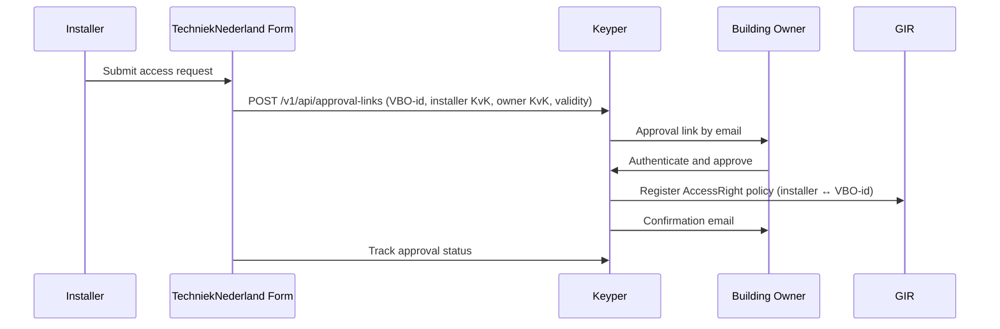

# Phase 1 — Owner Authorization

> **Context**: This is Phase 1 of the [Datastekker flow](datastekker.md). The installer requests, via the TechniekNederland form, that the building owner authorizes access to performance data. This phase runs once per installer / building combination. Phase 1 and Phase 2 are independent of each other and can be initiated simultaneously.

## Functional Overview

The TechniekNederland form collects the access request and hands it off to Keyper. Keyper notifies the building owner, who authenticates and approves. On approval, Keyper automatically registers the `AccessRight` policy in GIR — no further action is needed from the installer or TechniekNederland.

| Actor | Role |
|-------|------|
| **Installer** | Initiates the access request via the TechniekNederland form. |
| **TechniekNederland Form** | Collects request data and calls Keyper. |
| **Keyper** | Orchestrates the approval flow via eHerkenning. Registers the `AccessRight` in GIR on approval and emails the building owner a confirmation. |
| **Building owner** | Approves or rejects the request. Before approving, the owner must tick two declarations on the Keyper approval screen: one about ownership of the building units, and one about responsibility and liability for use of the shared data. |
| **GIR** | Stores the resulting `AccessRight` policy. |



## Technical Implementation

### Prerequisites

| Requirement | Details |
|-------------|---------|
| DSGO membership | All parties, including the building owner, must be registered in DSGO |
| Keyper access token | See [Keyper API Authentication](../keyper/api-authentication.md) |

### Step 1: Submit the request via the TechniekNederland form

Before calling Keyper, TechniekNederland collects the following information:

| Field | Description |
|-------|-------------|
| VBO-id | BAG Verblijfsobjectidentificatie — 16-digit building identifier |
| Installer KvK | KvK number of the installation company requesting access |
| Building owner KvK | KvK number of the owner who must approve |
| Building owner email | Recipient of the Keyper approval link |
| Validity period | Start and end date of the requested access |

The form then creates the approval link in Keyper:

```http
POST https://keyper-preview.poort8.nl/v1/api/approval-links
Authorization: Bearer <KEYPER_ACCESS_TOKEN>
Content-Type: application/json
```

```json
{
  "requester": {
    "name": "<INSTALLER_NAME>",
    "email": "<INSTALLER_EMAIL>",
    "organization": "<INSTALLER_COMPANY_NAME>",
    "organizationId": "did:ishare:EU.NL.NTRNL-<INSTALLER_KVK>"
  },
  "approver": {
    "email": "<BUILDING_OWNER_EMAIL>",
    "organization": "<BUILDING_OWNER_ORGANISATION>",
    "organizationId": "did:ishare:EU.NL.NTRNL-<BUILDING_OWNER_KVK>"
  },
  "dataspace": {
    "baseUrl": "https://gir-preview.poort8.nl"
  },
  "addPolicyTransactions": [
    {
      "subjectId": "did:ishare:EU.NL.NTRNL-<INSTALLER_KVK>",
      "resourceId": "<BAG_VBO_ID_16_DIGITS>"
    }
  ],
  "orchestration": {
    "flow": "dsgo.gir-datastekker@v1"
  }
}
```

Store the `id` from the response for [Step 4](#step-4-track-the-approval-status).

### Step 2: Keyper sends an approval link to the building owner

Keyper sends the building owner an email with an approval link. The owner signs in with eHerkenning for the KvK number in `approver.organizationId`, reviews the request and approves or rejects. After approval, the owner receives a confirmation email.

The link is valid for 1 hour. After that, the owner can request a new link from the same page for up to 7 days. After a rejection, a new request must be initiated.

### Step 3: Keyper registers the AccessRight in GIR

On approval, Keyper registers the policy in GIR. The policy is immediately active; Datastekker can enforce it on every subsequent data request.

> Keyper supplies these policy values: `issuerId` = `approver.organizationId`, `type` = `GIRDatastekker`, `action` = `can_read`, `serviceProvider` = `did:ishare:EU.NL.NTRNL-17162509` (2BA), `license` = `DSGO.0010`, and `useCase` = `dsgo.gir-datastekker`. `attribute` is optional and defaults to `*`. `notBefore` and `expiration` are optional Unix timestamps in seconds; if omitted, Keyper defaults them to `now` and `now` + 1 year respectively. `issuedAt` is set when the policy is approved and must not be supplied. Supplying a different fixed value returns `400 Bad Request`.

### Step 4: Track the approval status

```http
GET https://keyper-preview.poort8.nl/v1/api/approval-links/{id}
Authorization: Bearer <KEYPER_ACCESS_TOKEN>
```

`status` moves from `Active` to `Approved`, `Rejected`, or `Expired`.

An unopened link stays `Active` after it expires (`expiresAtUtc` in the create response). If the owner requests a new link, approval happens on a new link with a new `id`, and the original `id` stays `Expired`.

🔗 [Keyper API Docs ➚](https://keyper-preview.poort8.nl/scalar/v1)
