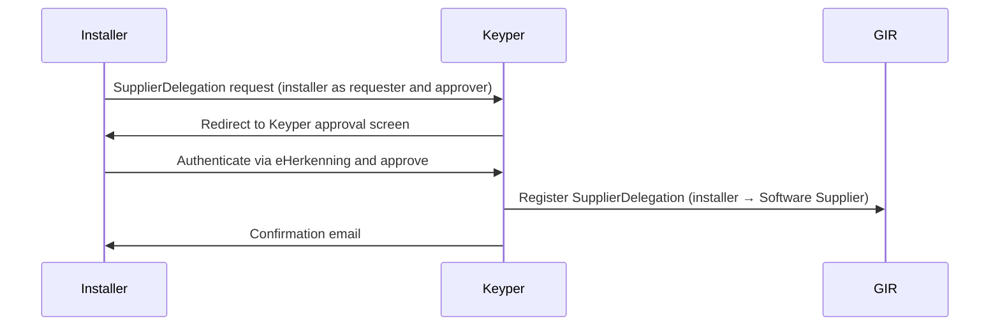

# Phase 2 — SupplierDelegation

> **Context**: This is Phase 2 of the [Datastekker flow](datastekker.md). It is only required if an installer uses an external Software Supplier to call Datastekker on their behalf. This phase can be executed independently or simultaneously with Phase 1.
>
> This page applies the generic [Supplier Delegation](supplier-delegation.md) pattern to Datastekker. See that page for how the Software Supplier fetches and presents delegation evidence and how the data service provider validates it.

## Functional Overview

The installer authorizes their Software Supplier to call Datastekker on their behalf. Unlike an `AccessRight` (which is issued by the building owner and scoped to a specific building/VBO-id), a `SupplierDelegation` is issued by the installer itself and is **generic**: it covers all transactions of type `GIRDatastekker`, regardless of VBO-id. One registration covers all buildings of that installer.

Because the installer is both requester and approver, Keyper forwards the requester directly to the approval screen — no building owner involvement is needed. On approval, Keyper registers the `SupplierDelegation` policy in GIR.

| | `AccessRight` | `SupplierDelegation` |
|---|---|---|
| **Issuer** | Building owner (rights holder) | Installer |
| **Subject** | Installer | Software Supplier |
| **Scope** | Resource-specific (VBO-id) | Generic (type level, `resourceId: "*"`) |
| **Trigger** | Once per building | Once per software relationship |

| Actor | Role |
|-------|------|
| **Installer** | Initiates and self-approves the delegation to their Software Supplier. |
| **Keyper** | Orchestrates the self-approval flow via eHerkenning, registers the `SupplierDelegation` in GIR and emails the installer a confirmation. |
| **Software Supplier** | Receives the delegation; authorized to call Datastekker on behalf of the installer in Phase 3. |
| **GIR** | Stores the resulting `SupplierDelegation` policy. |



## Technical Implementation

### Prerequisites

| Requirement | Details |
|-------------|---------|
| DSGO membership | Both parties must be registered in DSGO |
| Keyper access token | See [Keyper API Authentication](../keyper/api-authentication.md) |

### Step 1: Submit the SupplierDelegation request

The approval link request is submitted to Keyper with both the requester and approver set to the installer (self-approval flow):

```http
POST https://keyper-preview.poort8.nl/v1/api/approval-links
Authorization: Bearer <KEYPER_ACCESS_TOKEN>
Content-Type: application/json
```

```json
{
  "requester": {
    "name": "<INSTALLER_CONTACT_NAME>",
    "email": "<INSTALLER_EMAIL>",
    "organization": "<INSTALLER_COMPANY_NAME>",
    "organizationId": "did:ishare:EU.NL.NTRNL-<INSTALLER_KVK>"
  },
  "approver": {
    "email": "<INSTALLER_APPROVER_EMAIL>",
    "organization": "<INSTALLER_COMPANY_NAME>",
    "organizationId": "did:ishare:EU.NL.NTRNL-<INSTALLER_KVK>"
  },
  "dataspace": {
    "baseUrl": "https://gir-preview.poort8.nl"
  },
  "addPolicyTransactions": [
    {
      "type": "GIRDatastekker",
      "action": "*",
      "license": "DSGO.0010",
      "subjectId": "did:ishare:EU.NL.NTRNL-<SOFTWARE_SUPPLIER_KVK>",
      "resourceId": "*",
      "attribute": "*",
      "notBefore": "<UNIX_TIMESTAMP>",
      "expiration": "<UNIX_TIMESTAMP>"
    }
  ],
  "orchestration": {
    "flow": "dsgo.gir-supplier-delegation@v1"
  }
}
```

The Keyper response includes a `url` field — redirect the installer to this URL to complete the self-approval. Keyper also emails this link to the approver. The link is valid for 1 hour. After approval, the approver receives a confirmation email.

On approval, Keyper registers the `SupplierDelegation` policy in GIR:

```json
{
  "type": "GIRDatastekker",
  "action": "*",
  "license": "DSGO.0010",
  "issuedAt": "<UNIX_TIMESTAMP>",
  "issuerId": "did:ishare:EU.NL.NTRNL-<INSTALLER_KVK>",
  "subjectId": "did:ishare:EU.NL.NTRNL-<SOFTWARE_SUPPLIER_KVK>",
  "resourceId": "*",
  "attribute": "*",
  "notBefore": "<UNIX_TIMESTAMP>",
  "expiration": "<UNIX_TIMESTAMP>"
}
```

- Unlike Phase 1, Keyper does not fill in fixed values for this flow. Supply the fields shown above.
- If omitted, `notBefore` defaults to now and `expiration` to now + 1 year.
- `resourceId: "*"` and `attribute: "*"` make the delegation generic — not tied to a specific VBO-id.
- `action: "*"` covers every action the installer is itself authorized for.
- Keyper derives `issuerId` from `approver.organizationId`.
- A generic `SupplierDelegation` does not widen what the Software Supplier can see. It only says *who* may call on the installer's behalf — the underlying `AccessRight` from Phase 1 remains the limiting factor.

> The `SupplierDelegation` mechanism is defined in the [DSGO afsprakenstelsel ➚](https://afsprakenstelseldsgo.atlassian.net/wiki/spaces/dsgo/pages/1025933400).

🔗 [Keyper API Docs ➚](https://keyper-preview.poort8.nl/scalar/v1)

### Step 2: Inform the Software Supplier

After approval, the installer informs their Software Supplier of the delegation.

For every request to Datastekker, the Software Supplier fetches delegation evidence from GIR with its own DSGO bearer token:

```http
POST https://gir-preview.poort8.nl/v1/api/delegation
Authorization: Bearer <GIR_ACCESS_TOKEN>
Content-Type: application/json

{
  "delegationRequest": {
    "policyIssuer": "did:ishare:EU.NL.NTRNL-<INSTALLER_KVK>",
    "target": {
      "accessSubject": "did:ishare:EU.NL.NTRNL-<SOFTWARE_SUPPLIER_KVK>"
    },
    "policySets": [{
      "policies": [{
        "target": {
          "resource": {
            "type": "GIRDatastekker",
            "identifiers": ["<VBO_ID>"],
            "attributes": ["*"]
          },
          "actions": ["can_read"],
          "environment": {
            "serviceProviders": ["did:ishare:EU.NL.NTRNL-17162509"]
          }
        },
        "rules": [{ "effect": "Permit" }]
      }]
    }]
  }
}
```

The response contains a `delegation_token` (JWT, valid for 30 seconds). Send it in the `delegation_evidence` header of the request to Datastekker.

### Step 3: Revoke a SupplierDelegation

The installer can revoke a `SupplierDelegation` themselves via the Keyper Manager portal. No involvement of the building owner is required.

In GIR Preview, Keyper Manager sign-in uses eHerkenning. Sign in with eHerkenning on behalf of the installer; Keyper Manager derives the organization from the KvK number in the eHerkenning session. See [How does authentication work?](../keyper/faq.md#how-does-authentication-work) in the Keyper FAQ.

🔗 [Keyper Manager ➚](https://keyper-preview.poort8.nl/)

---

## Authorization check in Phase 3

Datastekker validates the delegation evidence and then checks the `AccessRight` of the installer — see [Phase 3, Step 4](datastekker-m2m-performance-data-transfer.md#step-4-verify-authorization-in-gir).
