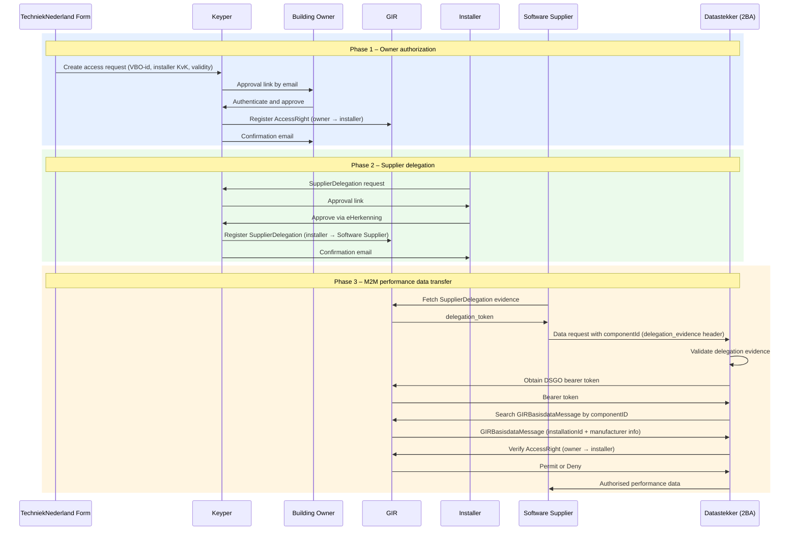

# Datastekker

> **⚠️ Design document — not ready for implementation**

Datastekker (developed by 2BA) retrieves performance data from installation manufacturers and translates it into uniform performance data using the Heatpump Common Ontology. To access this data, an installer needs explicit consent from the building owner. GIR manages that authorization.

## Parties

| Party | DSGO role | Description |
|-------|-----------|-------------|
| Installer | Data service consumer | Installation company requesting access to performance data for buildings they maintain. |
| Software Supplier *(optional)* | Authorized data service consumer | Receives a `SupplierDelegation` from the installer; calls Datastekker on the installer's behalf. |
| Building owner | Data service rights holder | Approves the access request; has authority over the installations in the building. |
| TechniekNederland | — | Hosts the form through which the access request is initiated. |
| Datastekker (2BA) | Data service provider | Retrieves installation data from manufacturers and exposes it via an API. Verifies authorization in GIR at request time. |
| Keyper *(Poort8)* | — | Orchestrates approval flows via eHerkenning. Registers policies in GIR on approval. |
| GIR | Installation register and authorization registry | Stores and enforces the `AccessRight` and `SupplierDelegation` policies at every data request. |

## Three phases

| Phase | What happens |
|-------|-------------|
| [Phase 1 — Owner Authorization](datastekker-owner-authorization.md) | Building owner approves the installer via eHerkenning. Keyper registers the `AccessRight` in GIR. |
| [Phase 2 — SupplierDelegation](datastekker-supplier-delegation.md) | Installer delegates to their Software Supplier. Keyper registers the `SupplierDelegation` in GIR. Optional; once per software relationship. |
| [Phase 3 — M2M Data Transfer](datastekker-m2m-performance-data-transfer.md) | The installer (or its Software Supplier) requests performance data from Datastekker. Datastekker obtains a DSGO bearer token, queries GIR by componentID, checks the `AccessRight` and returns authorised data. |

## DSGO authorization types

| Type | Meaning |
|------|---------|
| `AccessRight` | The building owner (rights holder) authorizes the installer (data service consumer) to read performance data (`GIRDatastekker`, `can_read`) for a building. Created in Phase 1. |
| `SupplierDelegation` | The installer authorizes their Software Supplier (authorized data service consumer) to call Datastekker on their behalf. Optional; created in Phase 2. See [Supplier Delegation](supplier-delegation.md). |

## Authorization scope

| Field | Values | What it does |
|-------|--------|---------------|
| `resourceId` | 16-digit BAG VBO-id | The `AccessRight` covers one building. |
| `attribute` | `"*"` (default), or a specific installation id | Matched per request against the installation id Datastekker sends in its authorization check ([Phase 3](datastekker-m2m-performance-data-transfer.md#step-4-verify-authorization-in-gir)): `"*"` matches any installation, a specific id matches only that one |

## Special cases

| Case | Implementation |
|------|----------------|
| **Multiple GIR records for the same componentID** | Querying `GIRBasisdataMessage` by `componentID` may return non-unique results. Handling these edge cases is the responsibility of the data service provider, for example with additional filters such as `vboID` or owner KvK. |

## Potential future extensions

The following topics are not blockers for the current integration but may be considered in later iterations.

**Predefined data-element sets**
Which fixed sets of data elements can be authorized? The definition of these sets determines how the `attribute` field in policy and delegation requests can be used beyond `*`.

**Attribute hierarchy in GIR *(optional)***
Consent is granted at the level of a predefined data-element set. At runtime, Datastekker may need to evaluate access at individual data-element level. This could be supported by declaring an attribute hierarchy on GIR modelled on the Heatpump Common Ontology (SAREF-based). Questions include whether GIR supports attribute hierarchies today, how sets map to ontology terms, and how versioning governance would work.

🔗 [GIR API Docs ➚](https://gir-preview.poort8.nl/scalar/v1) · [Keyper API Docs ➚](https://keyper-preview.poort8.nl/scalar/v1)
