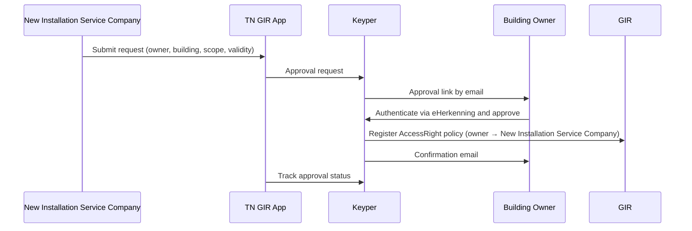

# Phase 1 — Owner Authorization

> **Context**: This is Phase 1 of the [Digitaal Onderhoudsboekje flow](digitaal-onderhoudsboekje.md). The New Installation Service Company initiates a request for the building owner to authorize the maintenance data transfer. Phase 1 and Phase 2 are independent of each other and can be initiated simultaneously.

## Functional Overview

The New Installation Service Company submits a request via the TN GIR App. Keyper sends an approval link to the building owner, who authenticates via eHerkenning and approves. On approval, Keyper registers the `AccessRight` policy in GIR.

| Actor | Role |
|-------|------|
| **New Installation Service Company** | Initiates the request. |
| **TN GIR App** | Collects request data and hands off to Keyper. Holds no credentials of its own. |
| **Keyper** | Orchestrates the approval flow via eHerkenning. Registers the `AccessRight` in GIR on approval and emails the building owner a confirmation. |
| **Building owner** | Approves or rejects the request via eHerkenning. Before approving, the owner must tick two declarations on the Keyper approval screen: one about ownership of the building units, and one about responsibility and liability for use of the shared data. |
| **GIR** | Stores the resulting `AccessRight` policy. |



## Technical Implementation

### Prerequisites

| Requirement | Details |
|-------------|---------|
| DSGO membership | All parties, including the building owner, must be registered in DSGO |
| Keyper access token | See [Keyper API Authentication](../keyper/api-authentication.md) |

### Step 1: Submit the request via the TN GIR App

The New Installation Service Company opens the Digitaal Onderhoudsboekje flow in the TN GIR App. The app looks up VBO-ids for the selected building via the Kadaster/BAG API.

Collected before handoff to Keyper:

| Field | Description |
|-------|-------------|
| Building owner email | Recipient of the approval link |
| Validity period | Start and end date of the requested access |
| NL/SfB filter | Optional — restricts access to specific NL/SfB classifications, e.g. `NLSfB-52.16` (see below) |

The app then creates the approval link in Keyper:

```http
POST https://keyper-preview.poort8.nl/v1/api/approval-links
Authorization: Bearer <KEYPER_ACCESS_TOKEN>
Content-Type: application/json
```

```json
{
  "requester": {
    "name": "<INSTALLER_NAME>",
    "email": "<INSTALLER_EMAIL>",
    "organization": "<INSTALLER_ORGANISATION>",
    "organizationId": "did:ishare:EU.NL.NTRNL-<NEW_INSTALLER_KVK>"
  },
  "approver": {
    "email": "<BUILDING_OWNER_EMAIL>",
    "organization": "<BUILDING_OWNER_ORGANISATION>",
    "organizationId": "did:ishare:EU.NL.NTRNL-<OWNER_KVK>"
  },
  "dataspace": {
    "baseUrl": "https://gir-preview.poort8.nl"
  },
  "addPolicyTransactions": [
    {
      "subjectId": "did:ishare:EU.NL.NTRNL-<NEW_INSTALLER_KVK>",
      "resourceId": "<BAG_VBO_ID_16_DIGITS>"
    }
  ],
  "orchestration": {
    "flow": "dsgo.gir-onderhoudsboekje@v1"
  }
}
```

> Multiple VBO-ids require one entry per VBO-id in `addPolicyTransactions`.

Store the `id` from the response for [Step 4](#step-4-track-the-approval-status).

### Step 2: Keyper sends an approval link to the building owner

Keyper sends the building owner an email with an approval link. The owner signs in with eHerkenning for the KvK number in `approver.organizationId` and can review the full request — which buildings, which New Installation Service Company, which scope, for how long — before approving or rejecting. After approval, the owner receives a confirmation email.

The link is valid for 1 hour. After that, the owner can request a new link from the same page for up to 7 days. After a rejection, a new request must be initiated.

### Step 3: Keyper registers the AccessRight in GIR

On approval, Keyper registers one `AccessRight` policy per VBO-id in GIR on behalf of the building owner.

> Keyper supplies these policy values: `issuerId` = `approver.organizationId`, `type` = `GIRMaintenanceLog`, `action` = `can_read`, `license` = `DSGO.0010`, and `useCase` = `dsgo.gir-onderhoudsboekje`. `serviceProvider` is optional and defaults to `*`, since the requester does not always know in advance which service provider holds the data; when supplied, it must be a valid iSHARE organization ID. `attribute` is optional and defaults to `*`. `notBefore` and `expiration` are optional Unix timestamps in seconds; if omitted, Keyper defaults them to `now` and `now` + 1 year respectively. `issuedAt` is set when the policy is approved and must not be supplied. Supplying a different fixed value returns `400 Bad Request`.

> **NL/SfB scoping**: to restrict access to specific NL/SfB classifications, add a `rules` field to the transaction, e.g. `"rules": "Classificaties(NLSfB-52.16,NLSfB-52.20)"`. Multiple codes are OR-matched. `rules` and `attribute` are independent conditions — GIR checks the classification it has itself registered for each installation and matches it against `rules` regardless of the `attribute` value; the requester cannot set the classification directly. `attribute` has its own, separate use: setting it to a specific installation id (instead of `"*"`) restricts the policy to that one installation, with or without a `rules` filter — see [Authorization scope](digitaal-onderhoudsboekje.md#authorization-scope).

### Step 4: Track the approval status

```http
GET https://keyper-preview.poort8.nl/v1/api/approval-links/{id}
Authorization: Bearer <KEYPER_ACCESS_TOKEN>
```

`status` moves from `Active` to `Approved`, `Rejected`, or `Expired`.

An unopened link stays `Active` after it expires (`expiresAtUtc` in the create response). If the owner requests a new link, approval happens on a new link with a new `id`, and the original `id` stays `Expired`.

🔗 [Keyper API Docs ➚](https://keyper-preview.poort8.nl/scalar/v1)
