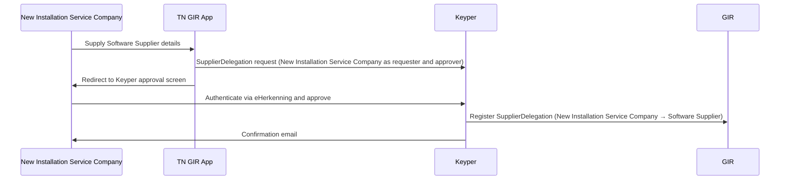

# Phase 2 — SupplierDelegation

> **Context**: This is Phase 2 of the [Digitaal Onderhoudsboekje flow](digitaal-onderhoudsboekje.md). It is only required if a New Installation Service Company uses an external Software Supplier to call data services on their behalf. This phase can be executed independently or simultaneously with Phase 1.
>
> This page applies the generic [Supplier Delegation](supplier-delegation.md) pattern to Digitaal Onderhoudsboekje. See that page for how the Software Supplier fetches and presents delegation evidence and how the data service provider validates it.

## Functional Overview

The New Installation Service Company authorizes their Software Supplier to call GIR data services on their behalf. Unlike an `AccessRight` (which is issued by the building owner and scoped to a specific building/VBO-id), a `SupplierDelegation` is issued by the New Installation Service Company itself and is **generic**: it covers all transactions of a given data service type, regardless of VBO-id. One registration covers all buildings and customers of that New Installation Service Company for that type.

Because the New Installation Service Company is both requester and approver, the TN GIR App can forward the requester directly to the approval link — no building owner involvement is needed. On approval, Keyper registers the `SupplierDelegation` policy in GIR.

| | `AccessRight` | `SupplierDelegation` |
|---|---|---|
| **Issuer** | Building owner (rights holder) | New Installation Service Company |
| **Subject** | New Installation Service Company | Software Supplier |
| **Scope** | Resource-specific (VBO-id) | Generic (type level, `resourceId: "*"`) |
| **Trigger** | Once per building | Once per software relationship |

| Actor | Role |
|-------|------|
| **New Installation Service Company** | Initiates and self-approves the delegation to their Software Supplier. |
| **TN GIR App** | Collects Software Supplier details and hands off to Keyper. |
| **Keyper** | Orchestrates the self-approval flow via eHerkenning, registers the `SupplierDelegation` in GIR and emails the New Installation Service Company a confirmation. |
| **Software Supplier** | Receives the delegation; authorized to call GIR data services on behalf of the New Installation Service Company in Phase 3. |
| **GIR** | Stores the resulting `SupplierDelegation` policy. |



## Technical Implementation

### Prerequisites

| Requirement | Details |
|-------------|---------|
| DSGO membership | Both parties must be registered in DSGO |
| Keyper access token | See [Keyper API Authentication](../keyper/api-authentication.md) |

### Step 1: Submit the SupplierDelegation request

The New Installation Service Company supplies the Software Supplier details in the TN GIR App and selects which GIR data service types to delegate. For `digitaal onderhoudsboekje`, this is `GIRBasisdataMessage` and `GIRMaintenanceLog`. The TN GIR App forwards the user directly to the Keyper approval screen. The New Installation Service Company authenticates via eHerkenning and self-approves.

The TN GIR App submits the approval link request to Keyper with both the requester and approver set to the New Installation Service Company (self-approval flow):

```http
POST https://keyper-preview.poort8.nl/v1/api/approval-links
Authorization: Bearer <KEYPER_ACCESS_TOKEN>
Content-Type: application/json

{
  "requester": {
    "name": "<NEW_INSTALLATION_SERVICE_COMPANY_CONTACT>",
    "email": "<NEW_INSTALLATION_SERVICE_COMPANY_EMAIL>",
    "organization": "<NEW_INSTALLATION_SERVICE_COMPANY>",
    "organizationId": "did:ishare:EU.NL.NTRNL-<NEW_INSTALLATION_SERVICE_COMPANY_KVK>"
  },
  "approver": {
    "email": "<NEW_INSTALLATION_SERVICE_COMPANY_APPROVER_EMAIL>",
    "organization": "<NEW_INSTALLATION_SERVICE_COMPANY>",
    "organizationId": "did:ishare:EU.NL.NTRNL-<NEW_INSTALLATION_SERVICE_COMPANY_KVK>"
  },
  "dataspace": {
    "baseUrl": "https://gir-preview.poort8.nl"
  },
  "addPolicyTransactions": [
    {
      "type": "GIRMaintenanceLog",
      "action": "*",
      "license": "DSGO.0010",
      "subjectId": "did:ishare:EU.NL.NTRNL-<SOFTWARE_SUPPLIER_KVK>",
      "resourceId": "*",
      "attribute": "*",
      "notBefore": "<UNIX_TIMESTAMP>",
      "expiration": "<UNIX_TIMESTAMP>"
    },
    {
      "type": "GIRBasisdataMessage",
      "action": "*",
      "license": "DSGO.0010",
      "subjectId": "did:ishare:EU.NL.NTRNL-<SOFTWARE_SUPPLIER_KVK>",
      "resourceId": "*",
      "attribute": "*",
      "notBefore": "<UNIX_TIMESTAMP>",
      "expiration": "<UNIX_TIMESTAMP>"
    }
  ],
  "orchestration": {
    "flow": "dsgo.gir-supplier-delegation@v1"
  }
}
```

The Keyper response includes a `url` field — redirect the New Installation Service Company to this URL to complete the self-approval. Keyper also emails this link to the approver. The link is valid for 1 hour. After approval, the approver receives a confirmation email.

On approval, Keyper registers one `SupplierDelegation` policy per selected data service type in GIR (example for `GIRMaintenanceLog`):

```json
{
  "type": "GIRMaintenanceLog",
  "action": "*",
  "license": "DSGO.0010",
  "issuedAt": "<UNIX_TIMESTAMP>",
  "issuerId": "did:ishare:EU.NL.NTRNL-<NEW_INSTALLATION_SERVICE_COMPANY_KVK>",
  "subjectId": "did:ishare:EU.NL.NTRNL-<SOFTWARE_SUPPLIER_KVK>",
  "resourceId": "*",
  "attribute": "*",
  "notBefore": "<UNIX_TIMESTAMP>",
  "expiration": "<UNIX_TIMESTAMP>"
}
```

- If omitted, `notBefore` defaults to now and `expiration` to now + 1 year.
- `resourceId: "*"` and `attribute: "*"` make the delegation generic — not tied to a specific VBO-id or NL/SfB scope.
- `action: "*"` covers all actions the New Installation Service Company is authorized to perform on that type.
- One policy entry per data service type (separate entries for `GIRBasisdataMessage` and `GIRMaintenanceLog`).
- The New Installation Service Company may have multiple active `SupplierDelegation` policies simultaneously — for example, different Software Suppliers per data type, or two suppliers in parallel during a migration.
- A generic `SupplierDelegation` does not widen what the Software Supplier can see. It only says *who* may call on the New Installation Service Company's behalf — the underlying `AccessRight` from Phase 1 remains the limiting factor, including any NL/SfB classification restriction (`rules: "Classificaties(...)"`) set on it.

> The `SupplierDelegation` mechanism is defined in the [DSGO afsprakenstelsel ➚](https://afsprakenstelseldsgo.atlassian.net/wiki/spaces/dsgo/pages/1025933400).

🔗 [Keyper API Docs ➚](https://keyper-preview.poort8.nl/scalar/v1)

### Step 2: Inform the Software Supplier

After approval, the New Installation Service Company informs their Software Supplier of the delegation and shares the relevant VBO-id(s) for business context (which buildings to query). The `SupplierDelegation` itself already covers all buildings and customers of the New Installation Service Company for the delegated type.

For every request to the previous installation service company's software, the Software Supplier fetches delegation evidence from GIR with its own DSGO bearer token:

```http
POST https://gir-preview.poort8.nl/v1/api/delegation
Authorization: Bearer <GIR_ACCESS_TOKEN>
Content-Type: application/json

{
  "delegationRequest": {
    "policyIssuer": "did:ishare:EU.NL.NTRNL-<NEW_INSTALLATION_SERVICE_COMPANY_KVK>",
    "target": {
      "accessSubject": "did:ishare:EU.NL.NTRNL-<SOFTWARE_SUPPLIER_KVK>"
    },
    "policySets": [{
      "policies": [{
        "target": {
          "resource": {
            "type": "GIRMaintenanceLog",
            "identifiers": ["<VBO_ID>"],
            "attributes": ["*"]
          },
          "actions": ["can_read"],
          "environment": {
            "serviceProviders": ["did:ishare:EU.NL.NTRNL-<PREVIOUS_PLATFORM_KVK>"]
          }
        },
        "rules": [{ "effect": "Permit" }]
      }]
    }]
  }
}
```

The response contains a `delegation_token` (JWT, valid for 30 seconds). Send it in the `delegation_evidence` header of the request to the previous installation service company's software.

### Step 3: Revoke a SupplierDelegation

The New Installation Service Company can revoke a `SupplierDelegation` themselves via the Keyper Manager portal. No involvement of the building owner is required.

In GIR Preview, Keyper Manager sign-in uses eHerkenning. Sign in with eHerkenning on behalf of the New Installation Service Company; Keyper Manager derives the organization from the KvK number in the eHerkenning session. See [How does authentication work?](../keyper/faq.md#how-does-authentication-work) in the Keyper FAQ.

🔗 [Keyper Manager ➚](https://keyper-preview.poort8.nl/)

---

## Authorization check in Phase 3

The previous installation service company's software validates the delegation evidence and then checks the `AccessRight` of the New Installation Service Company — see [Phase 3, Step 3](digitaal-onderhoudsboekje-m2m-maintenance-data-transfer.md#step-3-verify-authorization-in-gir).
