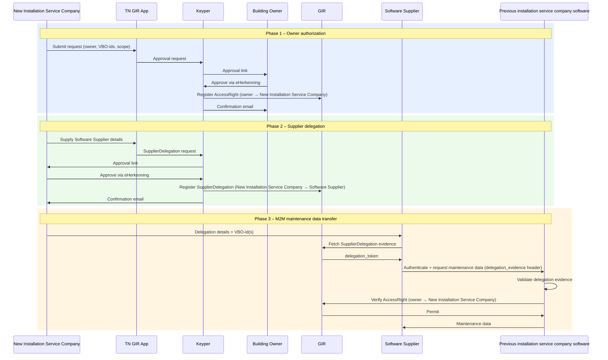

# Digitaal Onderhoudsboekje

When a building changes installation service company, the maintenance history is typically locked in the previous installation service company's software. **Digitaal Onderhoudsboekje** defines the authorization model and M2M transfer protocol that enables the building owner to authorize a transfer, allowing the New Installation Service Company to automatically retrieve maintenance history from the previous installation service company, using GIR to store and enforce access rights.

## Parties

| Party | DSGO role | Description |
|-------|-----------|-------------|
| Building owner | Data service rights holder | Approves the transfer via eHerkenning. |
| New Installation Service Company | Data service consumer | Initiates the request; receives the `AccessRight` from the building owner. |
| Software Supplier *(optional)* | Authorized data service consumer | Receives a `SupplierDelegation` from the New Installation Service Company; performs the M2M data retrieval. |
| Previous installation service company's software | Data service provider | Serves maintenance data and verifies authorization in GIR at request time. |
| TN GIR App *(TechniekNederland)* | — | Shared portal for GIR permission flows. Holds no credentials. |
| Keyper *(Poort8)* | — | Orchestrates approval flows via eHerkenning. Registers policies in GIR on approval. |
| GIR | Installation register and authorization registry | Stores GIRBasisdataMessages (latest copy only) and enforces `AccessRight` and `SupplierDelegation` policies. |

## Three phases

| Phase | What happens |
|-------|-------------|
| [Phase 1 — Owner Authorization](digitaal-onderhoudsboekje-owner-authorization.md) | Building owner approves the New Installation Service Company via eHerkenning. Keyper registers the `AccessRight` in GIR. |
| [Phase 2 — SupplierDelegation](digitaal-onderhoudsboekje-supplier-delegation.md) | New Installation Service Company delegates to their Software Supplier. Keyper registers the `SupplierDelegation` in GIR. Optional; once per software relationship. |
| [Phase 3 — M2M Data Transfer](digitaal-onderhoudsboekje-m2m-maintenance-data-transfer.md) | Software Supplier retrieves maintenance data directly from the previous installation service company's software, presenting delegation evidence from GIR. The previous installation service company's software validates the evidence and verifies the `AccessRight` in GIR at request time. |
## DSGO authorization types

| Type | Meaning |
|------|---------|
| `AccessRight` | The building owner (rights holder) authorizes the New Installation Service Company (data service consumer) to read maintenance data (`GIRMaintenanceLog`, `can_read`) for a building. Created in Phase 1. |
| `SupplierDelegation` | The New Installation Service Company authorizes their Software Supplier (authorized data service consumer) to act on their behalf. Optional; created in Phase 2. See [Supplier Delegation](supplier-delegation.md). |

## Authorization scope

`attribute` and `rules` are separate, independent conditions on the policy — both must pass, but neither depends on the other being set a particular way:

| Field | Values | What it does |
|-------|--------|---------------|
| `resourceId` | 16-digit BAG VBO-id | The `AccessRight` covers one building. |
| `attribute` | `"*"` (default), or a specific installation id | Matched per request against the installation id the data provider sends in its authorization check ([Phase 3](digitaal-onderhoudsboekje-m2m-maintenance-data-transfer.md#step-3-verify-authorization-in-gir)): `"*"` matches any installation, a specific id matches only that one |
| `rules` | Absent (default), or `"Classificaties(<NLSfB-code>,...)"` | Absent means no classification restriction; otherwise GIR looks up the NL/SfB classification it has registered for the installation under check and matches it against the listed codes. Installations without an NL/SfB code never match. |

The typical partial-transfer case — "any installation with classification 52.16 or 52.20" — keeps `attribute: "*"` and adds `rules: "Classificaties(NLSfB-52.16,NLSfB-52.20)"`. Restricting `attribute` to one specific installation id is a separate, narrower option that works with or without a classification `rules` filter.

Either way, `attribute` never carries a classification value — the requester cannot influence the classification outcome by claiming a different one.

> **What is an NL/SfB code?** NL/SfB is the standard classification for building and installation elements used across the Dutch construction sector. `NLSfB-<code>` here always refers to *table 1* of that standard (functional elements/installations) — e.g. `52.16` identifies heat pumps. GIR stores one such code per registered installation.

## Special cases

| Case | Implementation |
|----------|--------|
| **Multiple New Installation Service Companies** | Each New Installation Service Company initiates their own approval request; the building owner approves each independently. |
| **Multiple previous installation service companies** | By default, each approval request uses a wildcard for service provider, effectively validating data transfer from any previous installation company. More granular permissions are possible, but not yet supported. |

🔗 [GIR API Docs ➚](https://gir-preview.poort8.nl/scalar/v1) · [Keyper API Docs ➚](https://keyper-preview.poort8.nl/scalar/v1)
