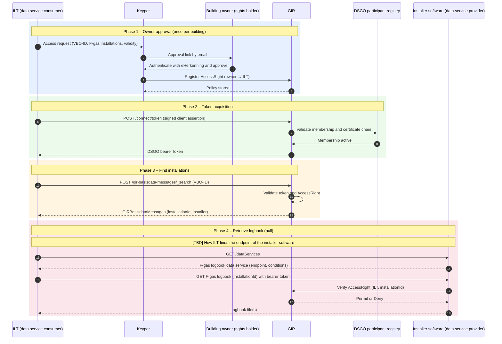

# F-Gas Logbooks – ILT Access Flow

> **⚠️ Design document — not ready for implementation**

The Human Environment and Transport Inspectorate (ILT) enforces the F-gas regulations. To do so, ILT needs the F-gas logbooks of installations. These logbooks are kept in the software of the installer. With the building owner's consent, ILT retrieves the logbooks machine-to-machine. GIR manages that consent and identifies the installations.

The flow follows the same pattern as the other GIR data consumers: owner approval via Keyper, a DSGO bearer token, and a GIR lookup of the installations in a building. The difference is the data source. ILT retrieves the logbook files from the installer's software, which checks authorization against GIR on every request. GIR does not store the logbooks.

## Parties

| Party | DSGO role | Description |
|-------|-----------|-------------|
| ILT | Data service consumer | Requests access to the F-gas logbooks of installations in a building. |
| Building owner | Data service rights holder | Approves the access request via eHerkenning. |
| Installer software | Data service provider | Holds the F-gas logbooks and checks authorization against GIR at request time. |
| Keyper *(Poort8)* | — | Orchestrates the approval flow. Registers the policy in GIR on approval. |
| GIR | Installation register and authorization registry | Identifies installations per building and stores and enforces the `AccessRight` policy. |
| DSGO participant registry | — | Confirms that ILT is an active DSGO participant during token acquisition. |

## End-to-end flow

## Four phases

| Phase | What happens | Frequency |
|-------|-------------|-----------|
| 1 — Owner approval | ILT requests access via Keyper. The building owner approves, and Keyper registers the `AccessRight` in GIR. | Once per building, until the policy expires |
| 2 — Token acquisition | ILT obtains a DSGO bearer token from GIR. See [Obtaining a DSGO Token](connect-token.md). | Per token expiry |
| 3 — Find installations | ILT searches GIR by VBO-ID and receives the authorized installations. See [Retrieve Multiple Installations](retrieve-installations.md). | Per inspection |
| 4 — Retrieve logbook | ILT pulls the logbook files from the installer software. The software checks the `AccessRight` in GIR before it returns data. | Per installation |

## Policy parameters

| Parameter | Description | Status |
|-----------|-------------|--------|
| `issuerId` | DID of the building owner (policy issuer) | Required |
| `subjectId` | DID of ILT (access subject) | Required |
| `resourceId` | 16-digit BAG VBO-ID. Consent is given per VBO and covers all installations registered under it, within the `rules` scope. | Required |
| `rules` | NL/SfB classifications of installations that contain F-gases, for example `Classificaties(NLSfB-52.16)` | [TBD] Exact set of codes |
| `notBefore` / `expiration` | Validity period of the granted access | Optional |

## Open points

| Topic | Status |
|-------|--------|
| **Finding the logbook endpoint** | Open. GIR does not yet record which software holds the logbook of an installation, or at which endpoint. A possible solution is a new Ketenstandaard together with a `/dataServices` endpoint per data service provider. |
| **Logbook format** | [TBD] File type and content of the F-gas logbook. |

## Decisions

| Topic | Decision |
|-------|----------|
| Legal basis | Consent of the building owner, approved via Keyper. |
| Retrieval | Pull: ILT retrieves the logbooks from the installer software. |

---

## Further reading

- [Data-Consumer Flow](data-consumer-flow.md)
- [Datastekker – Installer Access Flow](datastekker.md)
- [Discovering Data Services](dataservices.md)
- [GIR API Docs ➚](https://gir-preview.poort8.nl/scalar/v1)
- [Keyper API Docs ➚](https://keyper-preview.poort8.nl/scalar/v1)
