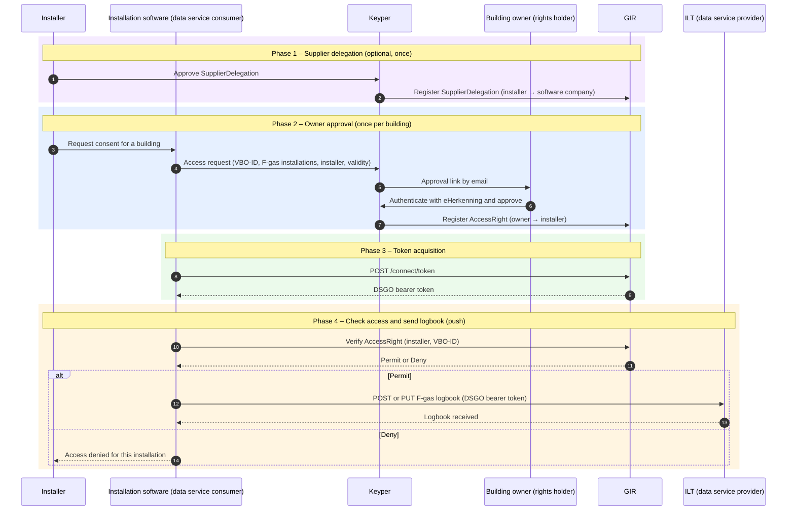

# F-Gas Logbooks – ILT Access Flow

> **⚠️ Design document — not ready for implementation**

The Human Environment and Transport Inspectorate (ILT) enforces the F-gas regulations. To do so, ILT needs the F-gas logbooks of installations. These logbooks are kept in the installation software of the installer. Installers currently report to ILT with Excel files. In this flow, the installation software sends the logbooks to ILT machine-to-machine, with the building owner's consent. GIR manages that consent.

The flow uses a push pattern: ILT exposes a webhook and the installation software sends the logbooks to it. The installer requests the owner's consent through the installation software, so the software knows which installations it sends logbooks for. Before each submission, the software checks the consent in GIR. GIR does not store the logbooks.

Most GIR flows are request-driven: the data service consumer requests the data from the data service provider. In this flow, the data service consumer sends the data to the data service provider.

## Parties

| Party | DSGO role | Description |
|-------|-----------|-------------|
| Installer | Legal data service consumer | Requests the owner's consent through the installation software and follows up when access is denied. |
| Software company | Data service consumer | Provides the installation software that holds the F-gas logbooks and sends them to ILT on behalf of the installer. |
| ILT | Data service provider | Exposes a webhook that receives the F-gas logbooks and accepts DSGO bearer tokens. |
| Building owner | Data service rights holder | Approves the consent request via eHerkenning. |
| Keyper *(Poort8)* | — | Orchestrates the approval flows. Registers the policies in GIR on approval. |
| GIR | Authorization registry | Stores the policies and returns Permit or Deny. |

## End-to-end flow

## Four phases

| Phase | What happens | Frequency |
|-------|-------------|-----------|
| 1 — Supplier delegation *(optional)* | The installer authorizes its software company to act for it. See [Supplier Delegation](supplier-delegation.md). If the installer sends the logbooks itself, this phase is skipped. | Once per software relationship |
| 2 — Owner approval | The installer requests consent through the installation software. The building owner approves via Keyper, and Keyper registers the `AccessRight` in GIR. | Once per building, until the policy expires |
| 3 — Token acquisition | The installation software obtains a DSGO bearer token. See [Obtaining a DSGO Token](connect-token.md). | Per token expiry |
| 4 — Check access and send logbook | The installation software checks the `AccessRight` in GIR. On Permit, it sends the logbook to the ILT webhook. On Deny, it reports back to the installer, who follows up with the building owner. | Per logbook submission |

## Policy parameters

| Parameter | Description | Status |
|-----------|-------------|--------|
| `issuerId` | DID of the building owner (policy issuer) | Required |
| `subjectId` | DID of the installer (access subject) | Required |
| `resourceId` | 16-digit BAG VBO-ID. Consent is given per VBO and covers all installations registered under it, within the `rules` scope. | Required |
| `rules` | NL/SfB classifications of installations that contain F-gases, for example `Classificaties(NLSfB-52.16)` | [TBD] Exact set of codes |
| `notBefore` / `expiration` | Validity period of the granted access | Optional |

## Open points

| Topic | Status |
|-------|--------|
| **ILT webhook** | [TBD] URL, and whether a submission uses POST or PUT. |
| **Resource type and action** | [TBD] `type` and `action` for the `AccessRight` and the `SupplierDelegation`. |
| **Logbook format** | [TBD] File type and content of the F-gas logbook. |

## Decisions

| Topic | Decision |
|-------|----------|
| Legal basis | Consent of the building owner to the installer, requested through the installation software and approved via Keyper. |
| Delivery | Push: the installation software sends the logbooks to a webhook exposed by ILT. |
| Authentication | The ILT webhook accepts DSGO bearer tokens. |
| Access check | The installation software checks the `AccessRight` in GIR before each submission. A deny goes back to the installer. |

---

## Further reading

- [Data Consumer](data-consumer-flow.md)
- [Datastekker](datastekker.md)
- [Supplier Delegation](supplier-delegation.md)
- [Discovering Data Services](dataservices.md)
- [GIR API Docs ➚](https://gir-preview.poort8.nl/scalar/v1)
- [Keyper API Docs ➚](https://keyper-preview.poort8.nl/scalar/v1)
