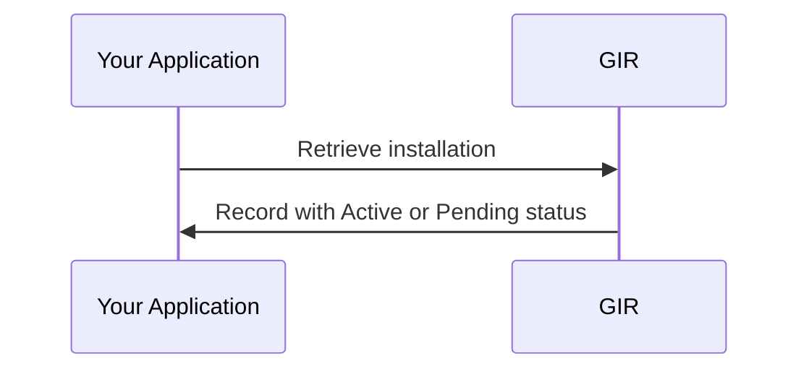

# Phase 4 — Activation Verification

> **Context**: This is Phase 4 of the [Registrar flow](registrar.md). It applies when a record from [Phase 3](registrar-m2m-installation-data-transfer.md) is stored as `Pending`.

## Functional Overview

After the owner approval in Keyper completes, GIR automatically promotes matching `Pending` records to `Active`. Your application retrieves the installation to verify its status.

| Actor | Role |
|-------|------|
| **Your application** | Retrieves the installation to check its status. |
| **GIR** | Promotes matching `Pending` records to `Active` after owner approval and returns the record with its status. |



Status does not affect visibility: the submitter (`metadata.issuer`) always sees the record; other parties only with a read `AccessRight` from the installation owner. A write `AccessRight` does not give read access.

A Software Supplier can read back the registrar's records only with a `SupplierDelegation` and the registrar's own read `AccessRight` — see [Phase 2 — SupplierDelegation](registrar-supplier-delegation.md#step-2-inform-the-software-supplier).

## Technical Implementation

### Step 1: Check the installation status

Filter by installation ID to check status:

```http
POST https://gir-preview.poort8.nl/api/gir/v0/gir-basisdata-messages/_search
Authorization: Bearer <GIR_ACCESS_TOKEN>
Content-Type: application/json

{ "installationID": { "value": "<INSTALLATION_ID>", "type": "GUID" } }
```

Use the installation identifier's `value` and `type` (`GUID` or `GIAI`) to look up the record; both must match. The single-record endpoint `GET /api/gir/v0/gir-basisdata-messages/{guid}` requires the GIR record GUID, not the installation ID.

### Step 2: Resolve records that stay Pending

Common causes of records staying `Pending`:

- Owner has not yet approved the Keyper request.
- Write targets a different VBO-id than the approved `AccessRight`.
- `installationOwnerChamberOfCommerceNumber` differs from the KvK number of the approver.
- Submission made by a Software Supplier with its own KvK number in `registrarChamberOfCommerceNumber` instead of the registrar's. Use the registrar's KvK number.

Verify that the VBO-id and KvK numbers in the write request exactly match the approved `AccessRight` — see [Phase 1, Step 1](registrar-owner-authorization.md#step-1-submit-the-request-to-keyper).

🔗 [GIR API Docs ➚](https://gir-preview.poort8.nl/scalar/v1)
