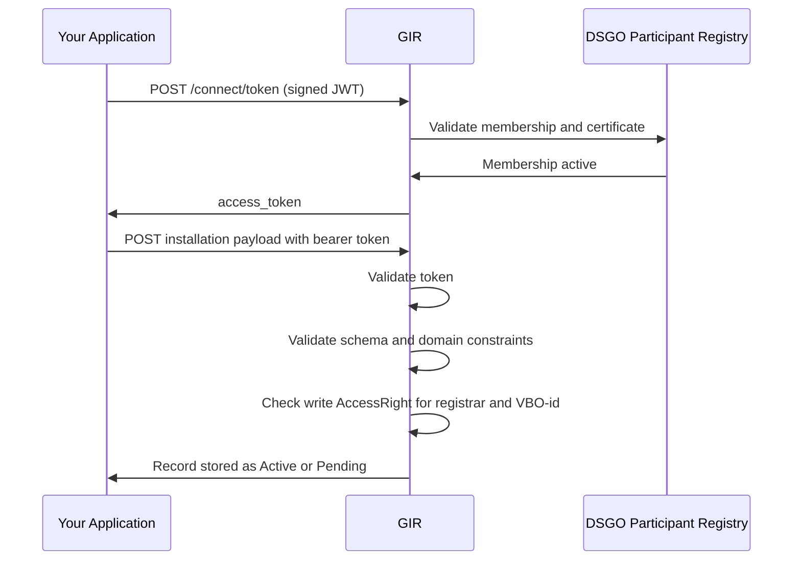

# Phase 3 — M2M Installation Data Transfer

> **Context**: This is Phase 3 of the [Registrar flow](registrar.md). A write `AccessRight` from [Phase 1](registrar-owner-authorization.md) is needed for the record to become `Active`; without it the record is stored as `Pending` (see [Phase 4](registrar-activation-verification.md)). The token acquisition in Step 1 can be started simultaneously with Phase 1.

## Functional Overview

Your application obtains a DSGO bearer token and submits installation data to GIR. The token authenticates your application; the write `AccessRight` from Phase 1 authorizes the write. GIR validates the token, the schema and the write `AccessRight`, and stores the record as `Active` or `Pending`.

| Actor | Role |
|-------|------|
| **Your application** | Creates the signed JWT, requests the token, and submits the installation payload with the bearer token. |
| **GIR** | Validates the JWT and certificate chain via the DSGO Participant Registry and issues the access token. On submission, validates token, schema, and write `AccessRight`, and returns the resulting status. |
| **DSGO Participant Registry** | Validates DSGO membership and certificate chain. |

## Technical Implementation

### Prerequisites

| Requirement | Details |
|-------------|---------|
| DSGO membership | Registered with `EU.DS.NL.DSGO` dataspace membership |
| RSA key pair + eSeal | eIDAS-qualified eSeal certificate with an RSA key pair, used to sign the JWT client assertion for GIR |

### Step 1: Obtain a DSGO bearer token

All GIR write requests require a DSGO bearer token. See [Obtaining a DSGO Token](connect-token.md) for the full procedure and JWT construction details. Repeat this step whenever the current token expires.

### Step 2: Submit the installation

The same endpoint handles create and update. Submitting the same installation ID again overwrites the existing record.

For payload schema and field requirements, see [Register or Update an Installation](insert-installation.md) and [GIR API Docs ➚](https://gir-preview.poort8.nl/scalar/v1).

Submit installations with your own DSGO bearer token and your own KvK number in `registrarChamberOfCommerceNumber`. A Software Supplier submitting on behalf of a registrar needs a `SupplierDelegation` from that registrar — see [Phase 2 — SupplierDelegation](registrar-supplier-delegation.md).

### Step 3: Check the write result

| Scenario | HTTP | `metadata.status` |
|----------|------|-------------------|
| Matching write `AccessRight` exists | `201` / `200` | `Active` |
| No matching write `AccessRight` | `201` / `200` | `Pending` |

The write `AccessRight` matches when the owner KvK, registrar KvK and `vboID` in your payload match the approval link — see [Phase 1, Step 1](registrar-owner-authorization.md#step-1-submit-the-request-to-keyper). A `Pending` record becomes `Active` once a matching write `AccessRight` exists — see [Phase 4 — Activation Verification](registrar-activation-verification.md).

🔗 [GIR API Docs ➚](https://gir-preview.poort8.nl/scalar/v1)
