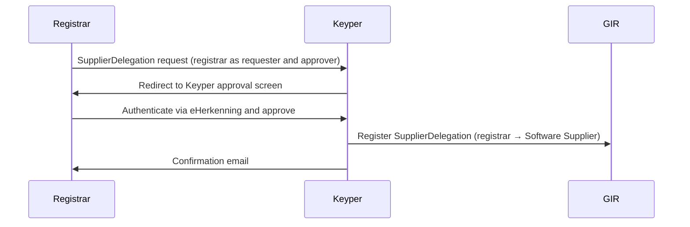

# Phase 2 — SupplierDelegation

> **Context**: This is Phase 2 of the [Registrar flow](registrar.md). It is only required if a registrar uses an external Software Supplier to submit or read back installation data on its behalf. This phase can be executed independently or simultaneously with Phase 1.
>
> This page applies the generic [Supplier Delegation](supplier-delegation.md) pattern to the registrar flow. See that page for how the Software Supplier fetches and presents delegation evidence.

## Functional Overview

The registrar authorizes their Software Supplier to call GIR on their behalf. Unlike the write `AccessRight` (which is issued by the installation owner and scoped to a specific building/VBO-id), a `SupplierDelegation` is issued by the registrar itself and is **generic**: it covers all transactions of type `GIRBasisdataMessage`, regardless of VBO-id. One registration covers all buildings of that registrar.

Because the registrar is both requester and approver, Keyper forwards the requester directly to the approval screen — no installation owner involvement is needed. On approval, Keyper registers the `SupplierDelegation` policy in GIR.

| | Write `AccessRight` | `SupplierDelegation` |
|---|---|---|
| **Issuer** | Installation owner (rights holder) | Registrar |
| **Subject** | Registrar | Software Supplier |
| **Scope** | Resource-specific (VBO-id) | Generic (type level, `resourceId: "*"`) |
| **Trigger** | Once per building | Once per software relationship |

| Actor | Role |
|-------|------|
| **Registrar** | Initiates and self-approves the delegation to their Software Supplier. |
| **Keyper** | Orchestrates the self-approval flow via eHerkenning, registers the `SupplierDelegation` in GIR and emails the registrar a confirmation. |
| **Software Supplier** | Receives the delegation; authorized to call GIR on behalf of the registrar. |
| **GIR** | Stores the resulting `SupplierDelegation` policy. As data service provider, GIR also validates the delegation evidence itself. |



## Technical Implementation

### Prerequisites

| Requirement | Details |
|-------------|---------|
| DSGO membership | Both parties must be registered in DSGO |
| Keyper access token | See [Keyper API Authentication](../keyper/api-authentication.md) |

### Step 1: Submit the SupplierDelegation request

The approval link request is submitted to Keyper with both the requester and approver set to the registrar (self-approval flow):

```http
POST https://keyper-preview.poort8.nl/v1/api/approval-links
Authorization: Bearer <KEYPER_ACCESS_TOKEN>
Content-Type: application/json
```

```json
{
  "requester": {
    "name": "<REGISTRAR_CONTACT_NAME>",
    "email": "<REGISTRAR_EMAIL>",
    "organization": "<REGISTRAR_ORGANIZATION>",
    "organizationId": "did:ishare:EU.NL.NTRNL-<REGISTRAR_KVK>"
  },
  "approver": {
    "email": "<REGISTRAR_APPROVER_EMAIL>",
    "organization": "<REGISTRAR_ORGANIZATION>",
    "organizationId": "did:ishare:EU.NL.NTRNL-<REGISTRAR_KVK>"
  },
  "dataspace": {
    "baseUrl": "https://gir-preview.poort8.nl"
  },
  "addPolicyTransactions": [
    {
      "type": "GIRBasisdataMessage",
      "action": "*",
      "license": "DSGO.0010",
      "subjectId": "did:ishare:EU.NL.NTRNL-<SOFTWARE_SUPPLIER_KVK>",
      "resourceId": "*",
      "attribute": "*",
      "notBefore": "<UNIX_TIMESTAMP>",
      "expiration": "<UNIX_TIMESTAMP>"
    }
  ],
  "orchestration": {
    "flow": "dsgo.gir-supplier-delegation@v1"
  }
}
```

The Keyper response includes a `url` field — redirect the registrar to this URL to complete the self-approval. Keyper also emails this link to the approver. The link is valid for 1 hour. After approval, the approver receives a confirmation email.

On approval, Keyper registers the `SupplierDelegation` policy in GIR:

```json
{
  "type": "GIRBasisdataMessage",
  "action": "*",
  "license": "DSGO.0010",
  "issuedAt": "<UNIX_TIMESTAMP>",
  "issuerId": "did:ishare:EU.NL.NTRNL-<REGISTRAR_KVK>",
  "subjectId": "did:ishare:EU.NL.NTRNL-<SOFTWARE_SUPPLIER_KVK>",
  "resourceId": "*",
  "attribute": "*",
  "notBefore": "<UNIX_TIMESTAMP>",
  "expiration": "<UNIX_TIMESTAMP>"
}
```

- Unlike Phase 1, Keyper does not fill in fixed values for this flow. Supply the fields shown above.
- If omitted, `notBefore` defaults to now and `expiration` to now + 1 year.
- `resourceId: "*"` and `attribute: "*"` make the delegation generic: it covers all buildings and installations of the registrar.
- `action: "*"` covers every action the registrar is itself authorized for.
- Keyper derives `issuerId` from `approver.organizationId`.
- A `SupplierDelegation` never widens access. It only says *who* may act for the registrar; the registrar's own write (or read) `AccessRight` remains the limiting factor.

> The `SupplierDelegation` mechanism is defined in the [DSGO afsprakenstelsel ➚](https://afsprakenstelseldsgo.atlassian.net/wiki/spaces/dsgo/pages/1025933400).

🔗 [Keyper API Docs ➚](https://keyper-preview.poort8.nl/scalar/v1)

### Step 2: Inform the Software Supplier

After approval, the registrar informs their Software Supplier of the delegation.

For every request to GIR, the Software Supplier fetches delegation evidence from GIR with its own DSGO bearer token, per installation:

```http
POST https://gir-preview.poort8.nl/v1/api/delegation
Authorization: Bearer <GIR_ACCESS_TOKEN>
Content-Type: application/json

{
  "delegationRequest": {
    "policyIssuer": "did:ishare:EU.NL.NTRNL-<REGISTRAR_KVK>",
    "target": {
      "accessSubject": "did:ishare:EU.NL.NTRNL-<SOFTWARE_SUPPLIER_KVK>"
    },
    "policySets": [{
      "policies": [{
        "target": {
          "resource": {
            "type": "GIRBasisdataMessage",
            "identifiers": ["<VBO_ID>"],
            "attributes": ["<GIR_INSTALLATION_ID>"]
          },
          "actions": ["can_read"],
          "environment": {
            "serviceProviders": ["did:ishare:EU.NL.NTRNL-76660680"]
          }
        },
        "rules": [{ "effect": "Permit" }]
      }]
    }]
  }
}
```

The response contains a `delegation_token` (JWT, valid for 30 seconds). Send it in the `delegation_evidence` header of the request to GIR.

| Use | Action in the evidence | Status |
|-----|------------------------|--------|
| Submit installations on behalf of the registrar ([Phase 3](registrar-m2m-installation-data-transfer.md)) | `can_write` | ⚠️ Upcoming |
| Read back the registrar's records | `can_read` | Supported, if the registrar also holds its own read `AccessRight` |

**Submitting on behalf of the registrar (⚠️ upcoming).** The Software Supplier submits with its own DSGO bearer token, the registrar's KvK number in `registrarChamberOfCommerceNumber`, and delegation evidence (action `can_write`) in the `delegation_evidence` header. GIR then checks the registrar's write `AccessRight`; without valid evidence the submission is rejected with `403 Forbidden`. See [Submit on behalf of another registrar](insert-installation.md#submit-on-behalf-of-another-registrar-software-supplier) for the steps.

**Reading back the registrar's records.** The Software Supplier fetches delegation evidence (action `can_read`) for one installation and sends it in the `delegation_evidence` header. GIR then evaluates the registrar's **read** `AccessRight`. Being the record's registrar is not enough: the registrar needs its own read `AccessRight` for the building, otherwise the Software Supplier gets an empty result (or `403` for a single record). Records the Software Supplier submitted itself are visible to it without evidence: GIR registers the submitter as `metadata.issuer`.

### Step 3: Revoke a SupplierDelegation

The registrar can revoke a `SupplierDelegation` themselves via the Keyper Manager portal. No involvement of the installation owner is required.

In GIR Preview, Keyper Manager sign-in uses eHerkenning. Sign in with eHerkenning on behalf of the registrar; Keyper Manager derives the organization from the KvK number in the eHerkenning session. See [How does authentication work?](../keyper/faq.md#how-does-authentication-work) in the Keyper FAQ.

🔗 [Keyper Manager ➚](https://keyper-preview.poort8.nl/)
