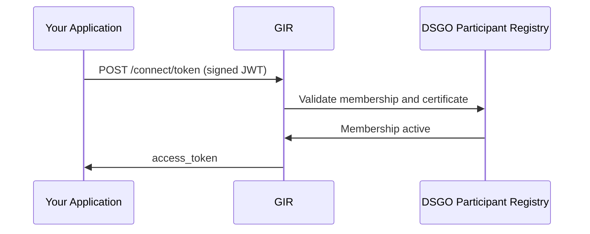

# Phase 2 — Token Acquisition

> Part of the [Registrar Integration Guide](registrar.md). Can be started simultaneously with [Keyper Approval](registrar-keyper-approval.md).

All GIR write requests require a DSGO bearer token. The token authenticates your application; the write policy (from Keyper Approval) authorizes the write. Both are required.

| Actor | Role |
|-------|------|
| **Your application** | Creates the signed JWT and requests the token. |
| **GIR** | Validates the JWT and certificate chain via the DSGO Participant Registry. Issues the access token. |

## Technical Implementation

See [Obtaining a DSGO Token](connect-token.md) for the full procedure and JWT construction details.

## References

- [GIR API Docs ➚](https://gir-preview.poort8.nl/scalar/v1)
- [DSGO Developer Portal ➚](https://digigo-nu.gitbook.io/dsgo-developer-portal/)

## Next

[Submit Installation](registrar-submit-installation.md)
