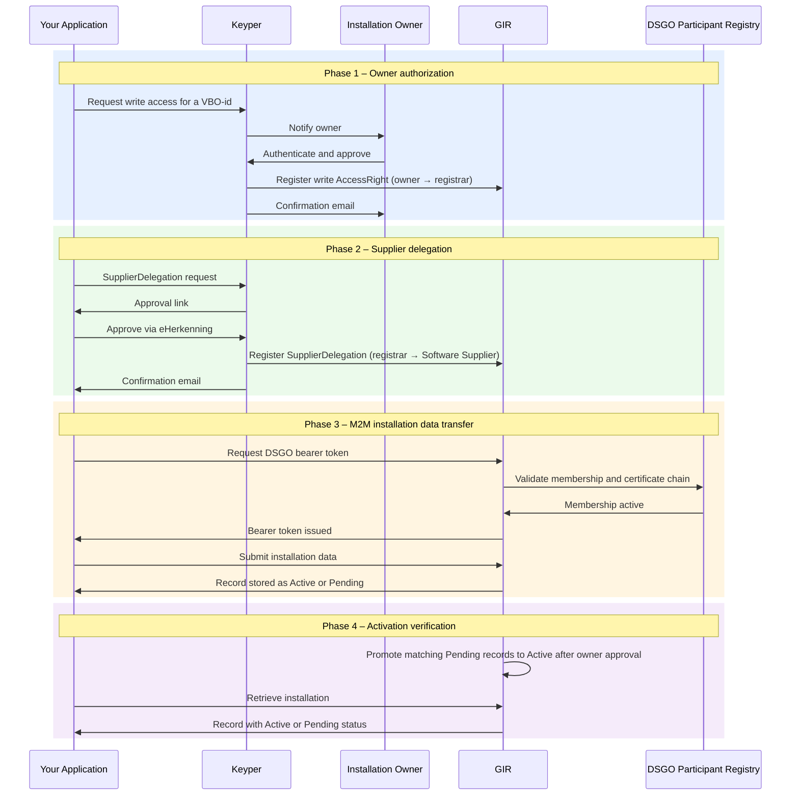

# Registrar

Registrars publish and maintain installation data in GIR. Your application calls GIR with a valid DSGO bearer token. A record becomes `Active` once your organization holds a write `AccessRight` for the building; until then, it is stored as `Pending`.

## Parties

| Party | DSGO role | Description |
|-------|-----------|-------------|
| Registrar (your application) | Data service provider | Submits and maintains installation data for buildings it is authorized to write. |
| Software Supplier *(optional)* | Authorized data service consumer | Receives a `SupplierDelegation` from the registrar; calls GIR on the registrar's behalf. |
| Installation owner | Data service rights holder | Approves write access for a specific building via Keyper. |
| Keyper *(Poort8)* | — | Orchestrates approval flows via eHerkenning. Registers policies in GIR on approval. |
| GIR | Installation register and authorization registry | Validates token and write `AccessRight` at write time. Stores records and governs visibility. |
| DSGO Participant Registry | — | Validates DSGO membership and certificate chain when a token is requested. |

## Four phases

| Phase | What happens |
|-------|-------------|
| [Phase 1 — Owner Authorization](registrar-owner-authorization.md) | Installation owner approves write access for a building via eHerkenning. Keyper registers the write `AccessRight` in GIR. |
| [Phase 2 — SupplierDelegation](registrar-supplier-delegation.md) | Registrar delegates to their Software Supplier. Keyper registers the `SupplierDelegation` in GIR. Optional; once per software relationship. |
| [Phase 3 — M2M Data Transfer](registrar-m2m-installation-data-transfer.md) | Your application obtains a DSGO bearer token and submits installation data to GIR. The record is stored as `Active` or `Pending`. |
| [Phase 4 — Activation Verification](registrar-activation-verification.md) | Verify post-approval visibility: a `Pending` record transitions to `Active` once a matching write `AccessRight` exists. |

## DSGO authorization types

| Type | Meaning |
|------|---------|
| `AccessRight` (write) | The installation owner (rights holder) authorizes the registrar to write installation data (`GIRBasisdataMessage`, `can_write`) for a building. Created in Phase 1. |
| `SupplierDelegation` | The registrar authorizes their Software Supplier (authorized data service consumer) to call GIR on their behalf. Optional; created in Phase 2. See [Supplier Delegation](supplier-delegation.md). |

## Authorization scope

| Field | Values | What it does |
|-------|--------|---------------|
| `resourceId` | 16-digit BAG VBO-id | The write `AccessRight` covers one building. |
| `attribute` | `"*"` (fixed) | Covers all installations in the building. |

## Special cases

| Case | Implementation |
|------|----------------|
| **Repeated updates on the same building** | Phase 1 usually does not need to be repeated until the `AccessRight` expires or the scope changes. The DSGO bearer token in Phase 3 is renewed whenever it expires. |
| **Writing before approval** | The record is stored as `Pending` and becomes `Active` once the owner approves. See [Phase 4](registrar-activation-verification.md). |

🔗 [GIR API Docs ➚](https://gir-preview.poort8.nl/scalar/v1) · [Keyper API Docs ➚](https://keyper-preview.poort8.nl/scalar/v1)
