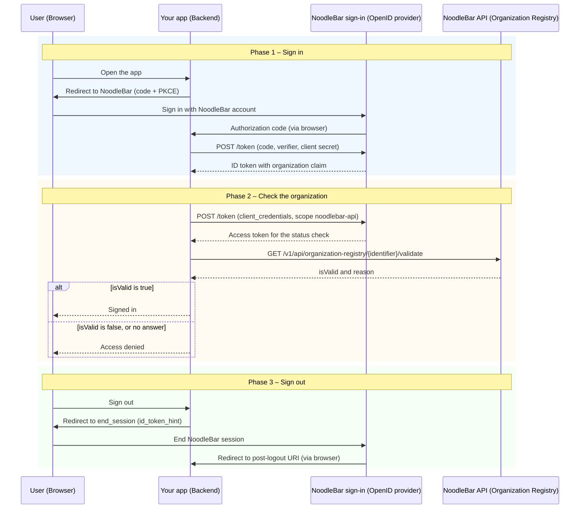

# Signing In With NoodleBar — Guide for App Developers

Let users sign in to your app with their existing NoodleBar account through OpenID Connect. You do not build your own account management: NoodleBar knows who the user is and which registered organization they belong to.

> **Preview.** This is a pilot. The integration contract can change.

This page has three parts:

- [Understand](#understand) explains what NoodleBar vouches for and what your app must check itself. Read it before you start.
- [How to connect your app](#how-to-connect-your-app) takes you through the integration, including the HTTP calls for the organization status check.
- [Reference](#reference) lists the endpoints, claims, lifetimes and status check rules.

## Understand

### What NoodleBar vouches for

When a user signs in, NoodleBar states two things in the ID token: who the user is, and which organization registered in the dataspace they are a member of. Users become members when their organization registers in the self-service portal or when an organization administrator invites them.

NoodleBar does not state:

- that the organization is currently an active participant; your app checks this itself
- which role the user has within the organization
- that the user may act on behalf of the organization

### Where this fits in the dataspace

Your app outsources sign-in to NoodleBar, but it remains responsible for what it does with the user's identity. When your app retrieves data, it does so with its own machine-to-machine token, not with the user's token. See [Authentication in dataspaces](authentication-in-dataspaces.md) (in Dutch) for the forms a dataspace can choose from; this pilot is form 1, in which the application vouches for its users, with sign-in outsourced to NoodleBar.

Because data services see your app's organization and not the user's, your app is responsible for showing each user only what their own organization may see.

The tokens your app receives at sign-in are for your app only. Do not send them to the NoodleBar API or to data services: they are not issued for those audiences, and the NoodleBar API rejects them.

### Why your app checks the organization status

An organization can be registered but not active: it can be waiting for approval, rejected, or revoked. In this pilot NoodleBar does not block sign-in for those organizations. Your app therefore asks NoodleBar whether the organization is active, at sign-in and periodically during the session, and refuses access when the answer is no or when no answer comes.

### When access ends

| Event | Effect in your app |
|-------|--------------------|
| The organization is revoked or no longer active | The next status check fails; requests are refused at most 5 minutes after the change |
| Poort8 revokes your status-check client | The status check cannot run; your app fails closed and refuses requests at most 5 minutes later |
| Poort8 removes your sign-in client | New sign-ins fail. Running sessions continue until the status check or the session ends them |
| A user is removed from the organization | The next sign-in has no organization and is refused. A session that is already running continues until it expires (at most 10 hours) |
| The user signs out of another app | No effect on your app's session |

### The user identifier

Use the `sub` claim as the key for a user, not the email address. `sub` stays the same for as long as the user's account exists; a new account gets a new `sub`. Every app in the dataspace receives the same `sub` for the same user, so do not treat it as a secret.

If you link NoodleBar users to existing accounts in your app, link on email only when `email_verified` is `true` and the user confirms the link. After that, use `sub`.

### Pilot limitations

- Poort8 registers and removes sign-in clients manually.
- NoodleBar does not enforce the organization status at sign-in; your app must.
- Roles within an organization are not available to apps.
- The tokens cannot be used for the NoodleBar API or for data services.
- Availability follows the service level of the NoodleBar instance; there is no separate commitment for sign-in.

## How to connect your app

### Before you begin

| Requirement | Description |
|-------------|-------------|
| **Organization registered** | Your organization is registered in the self-service portal and has been approved |
| **User account active** | You have an active user account on the self-service portal (`https://{domain}.poort8.nl/portal`) |
| **App with a backend** | Your app has a server-side component that can keep a client secret. Browser-only apps are not supported in the pilot |
| **Redirect URIs known** | You know the exact URLs your app uses after sign-in and after sign-out |

### Overview

<div data-flow-player="media/sign-in-with-noodlebar.scene.json"></div>



### Step 1 — Request a sign-in client

Ask Poort8 for a sign-in client via **hello@poort8.nl** and provide:

- the name of your app
- the exact redirect URIs, for ASP.NET Core `https://{your-app}/signin-oidc`
- the exact post-logout redirect URIs, for ASP.NET Core `https://{your-app}/signout-callback-oidc`

Wildcards are not accepted. Localhost URIs are accepted for the preview environment only.

You receive the `issuer`, the `client_id` and a `client_secret`. Poort8 shares the secret through a secure channel. Store it as a secret in your app, never in source control.

### Step 2 — Register a status-check client

The status check needs a separate machine-to-machine client. Register it in the self-service portal as described in [Requesting API Access](requesting-api-access.md), steps 1 to 3:

1. Register your application in the portal and copy its client ID and secret.
2. Request access to the **NoodleBar** API (by Poort8 B.V.). Poort8 approves the request.
3. Request tokens with `grant_type=client_credentials` and `scope=noodlebar-api`.

Use this client only for the status check.

### Step 3 — Configure OpenID Connect

Use the OpenID Connect library of your stack, such as `Microsoft.AspNetCore.Authentication.OpenIdConnect` for .NET. Do not implement the protocol yourself. Configure the library with:

| Setting | Value |
|---------|-------|
| Issuer (authority) | `https://auth.poort8.nl/realms/{realm}`; the library reads all endpoints from the discovery document |
| Client ID and secret | From step 1 |
| Response type | `code` |
| PKCE | `S256` |
| Scopes | `openid profile email organization` |
| Redirect URI and post-logout redirect URI | As registered in step 1 |
| Tokens to keep | The ID token, for sign-out. Your app does not need the access or refresh token |
| Session length | At most 10 hours from sign-in, not extended by activity |

The `organization` claim is a JSON object. Make sure your library keeps it as a claim, unchanged.

### Step 4 — Refuse users without an active organization

After your library has validated the ID token and before it creates the session, check the organization. Most libraries offer a hook for this, such as the `OnTokenValidated` event in ASP.NET Core; in libraries where you handle the callback yourself, do it in that handler.

1. Read the `organization` claim. Refuse the user if it is missing or does not hold exactly one organization with exactly one identifier of your dataspace's type (`EUID` in most dataspaces [TBD - instance specific]). Select the value from that identifier's array, for example `organization["NLNHR.12345678"].EUID[0]`; see [Organization claim](#organization-claim).
2. Get an access token for your status-check client. Reuse it until it expires.
3. Call the validate endpoint with that identifier. Use a short timeout of a few seconds.
4. Admit the user only on `isValid: true`. Refuse on any other answer, on an error and on a timeout, and show the user an access-denied page rather than an error.

The two HTTP calls:

```bash
curl -X POST https://auth.poort8.nl/realms/{realm}/protocol/openid-connect/token \
  -H "Content-Type: application/x-www-form-urlencoded" \
  -d "grant_type=client_credentials" \
  -d "client_id=YOUR_STATUS_CLIENT_ID" \
  -d "client_secret=YOUR_STATUS_CLIENT_SECRET" \
  -d "scope=noodlebar-api"

curl https://{domain}.poort8.nl/v1/api/organization-registry/NLNHR.12345678/validate \
  -H "Authorization: Bearer ACCESS_TOKEN"
```

The answer and the full rules are under [Validate endpoint](#validate-endpoint) and [Status check requirements](#status-check-requirements).

### Step 5 — Recheck the organization during the session

Run the same check while the session lasts and end the session when it fails:

- Cache a positive answer per organization for at most 5 minutes. With a 5-minute cache your app calls NoodleBar about once per organization per 5 minutes for each app instance.
- Check on each request that reaches your backend; the cache keeps the calls to NoodleBar within the limit. In ASP.NET Core with cookie sessions, the `OnValidatePrincipal` event is the place.
- Long-lived connections, such as WebSockets or server-side UI circuits, do not pass this check after they open. Recheck them at least every 5 minutes and close them when the check fails.

### Step 6 — Sign users out

Use your library's sign-out (RP-initiated logout). It ends the session in your app and redirects the user to the `end_session_endpoint` from the discovery document, with the ID token as `id_token_hint` and your registered post-logout redirect URI. NoodleBar ends its own session and redirects back to your app. Your library needs the ID token for this, so keep it in the session. Protect your sign-out endpoint against cross-site requests, for example with an antiforgery token.

### Step 7 — Test your integration

Test in the preview environment before you go live:

1. Sign in with a user of an active organization. The user is signed in, and your app has the `sub`, `email` and `organization` claims.
2. Register a test organization in the preview portal and do not ask for approval. Sign in with its administrator: the app must refuse access.
3. Point the status check to an unreachable NoodleBar API address. New sign-ins must be refused, and a running session must end within 5 minutes.
4. Sign out, then open the app again. NoodleBar must ask you to sign in again.
5. Ask Poort8 to approve a test organization and then revoke it while one of its users is signed in. That session must end within 5 minutes.

## Reference

### Endpoints

All OpenID Connect endpoints are in the discovery document. Poort8 sends you the values for your environment with your sign-in client.

| Resource | URL pattern |
|----------|-------------|
| **Issuer** | `https://auth.poort8.nl/realms/{realm}` |
| **Discovery** | `https://auth.poort8.nl/realms/{realm}/.well-known/openid-configuration` |
| **Token endpoint** | `https://auth.poort8.nl/realms/{realm}/protocol/openid-connect/token` |
| **NoodleBar API** | `https://{domain}.poort8.nl` |
| **API reference** | `https://{domain}.poort8.nl/scalar/v1` |
| **Self-service portal** | `https://{domain}.poort8.nl/portal` |

`{realm}` and `{domain}`: [TBD - instance specific].

### Sign-in client

| Setting | Value |
|---------|-------|
| Client type | Confidential, authenticated with a client secret |
| Flow | Authorization code |
| PKCE | Required, `S256` |
| Redirect URIs | Exact match, no wildcards; localhost on preview only |
| Post-logout redirect URIs | Exact match |
| Offline access | Not available |

### Scopes

| Scope | Adds |
|-------|------|
| `openid` | Required for OpenID Connect; `sub` |
| `profile` | `name`, `given_name`, `family_name`, `preferred_username` |
| `email` | `email`, `email_verified` |
| `organization` | `organization` |

### ID token claims

| Claim | Meaning |
|-------|---------|
| `sub` | Stable user identifier. Use it as the key for a user; see [The user identifier](#the-user-identifier) |
| `email` | The user's email address |
| `email_verified` | Whether the email address has been verified |
| `name`, `given_name`, `family_name` | The user's name; can be absent |
| `preferred_username` | The user's username at NoodleBar |
| `organization` | The organization the user signed in for; see below |

Your OpenID Connect library validates the standard claims such as `iss`, `aud`, `exp` and `nonce`.

### Organization claim

The ID token has the same `organization` claim as the access tokens described in [Validating API Tokens](validating-api-tokens.md#organization-claim): an object with one entry per organization, keyed by its EUID, holding `id` and the registered identifiers as arrays.

```json
{
  "organization": {
    "NLNHR.12345678": {
      "id": "550e8400-e29b-41d4-a716-446655440000",
      "EUID": ["NLNHR.12345678"],
      "KVK": ["12345678"]
    }
  }
}
```

A user who is a member of several organizations chooses one when signing in, so the claim holds one organization. Refuse access when it holds none or more than one.

### Lifetimes

| Item | Lifetime |
|------|----------|
| Access tokens, for sign-in and for the status check | 5 minutes |
| NoodleBar sign-in session | Ends after 30 minutes without activity at NoodleBar, at most after 10 hours |
| Your app's session | Set by your app; at most 10 hours from sign-in |

### Validate endpoint

```http
GET /v1/api/organization-registry/{identifier}/validate
Authorization: Bearer {status-check access token}
```

`{identifier}` is the first and only value in the array for the identifier type your dataspace uses, for example `organization["NLNHR.12345678"].EUID[0]`. URL-encode it. Do not use the `id` property or the key outside the organization's object; they are not the registry identifier for this endpoint. An authorized request gets `200 OK`, also when the organization is not active. `401` or `403` means the status-check token is missing, expired or not issued for `noodlebar-api`. The body:

```json
{
  "isValid": true,
  "reason": "OrganizationActive"
}
```

| `reason` | `isValid` | Meaning |
|----------|-----------|---------|
| `OrganizationActive` | `true` | The organization is an active participant |
| `OrganizationPending` | `false` | Registered, waiting for approval |
| `OrganizationRejected` | `false` | Registration rejected |
| `OrganizationRevoked` | `false` | Participation revoked |
| `OrganizationNotFound` | `false` | No organization with this identifier |
| `ValidationFailed` | `false` | NoodleBar could not determine the status |

Only `isValid: true` grants access. Do not base access decisions on `reason`; use it for logging and for the message you show the user. See the API reference of your instance for the full schema.

### Status check requirements

| Situation | Your app |
|-----------|----------|
| Sign-in | **Must** call the validate endpoint and admit the user only on `isValid: true` |
| No `organization` claim, or not exactly one organization or identifier | **Must** refuse without calling the validate endpoint |
| Positive answer | **Must not** cache it for longer than 5 minutes; cache per organization |
| Running session | **Must** recheck when the cached answer expires and end the session on a negative answer |
| Error, timeout, `401`, `403` or `5xx` | **Must** refuse or end the session; never let the user in on an error |
| Negative answer | **Should not** be cached, so a reactivated organization regains access at once |
| Session length | **Must not** exceed 10 hours from sign-in |
